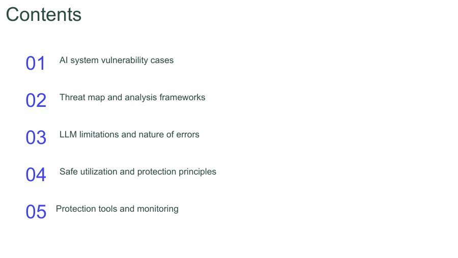

# Lab 1 - Introduction: smoke test

## 1. Read

Good afternoon. Today we will dive into AI security in practice. Specifically, we will look at vulnerability cases in real AI systems.

We will go through threat maps and the frameworks used to analyze them. We will understand the limitations of large language models and the nature of their errors. We will look at how to use AI safely, what protective measures exist, and what protection and monitoring tools are available.


*Figure 2*

**Key takeaways**

- The lecture covers five areas: real cases, threat maps and frameworks, LLM limitations, safe use, and protection tools with monitoring.

## 2. Goal

Check that everything is installed and works. You also see, in one tiny test, why later labs repeat every attack many times: the model gives different answers to the same question.

## 3. Do it

### Step 1 - Download the models

```bash
bash lessons/lab1/lab1a_pull_models.sh
```

Pulls the six local models used in the course (several GB).

**You should see:** The script ends with a list of models (`ollama list`).

### Step 2 - Record your machine

```bash
python lessons/lab1/lab1b_environment.py
```

Writes down Ollama version, models, Python, RAM and GPU.

**You should see:** One line with your setup. Keep it for the write-up.

### Step 3 - Smoke test

```bash
python lessons/lab1/lab1c_smoke_test.py
```

Asks the same question twice with a fixed seed and twice with random sampling.

**You should see:**

- The two fixed-seed answers are **identical**.
- The two sampled answers **differ**. So one successful attack proves little: you must measure a rate.

## 4. Write up

Write your answers in the **Lab 1** section of [`deliverables.md`](../../deliverables.md). What to hand in:

- **Environment** - Output of `lab1b_environment.py` (Ollama version, models, Python, RAM, GPU).
- **Seed vs sampling** - 3-5 sentences: what you saw with a fixed seed vs temperature 0.9, and why it matters for measuring attack success *rates*.

## 5. Go further (optional)

- Run the smoke test on the second model: `AISEC_MODEL=qwen2.5:3b` (see *Settings* in the [main README](../../README.md#settings)).

## If something goes wrong

- "Cannot reach Ollama": start the Ollama app or run `ollama serve`.
- Windows: use WSL2 for the `.sh` scripts and Docker.
