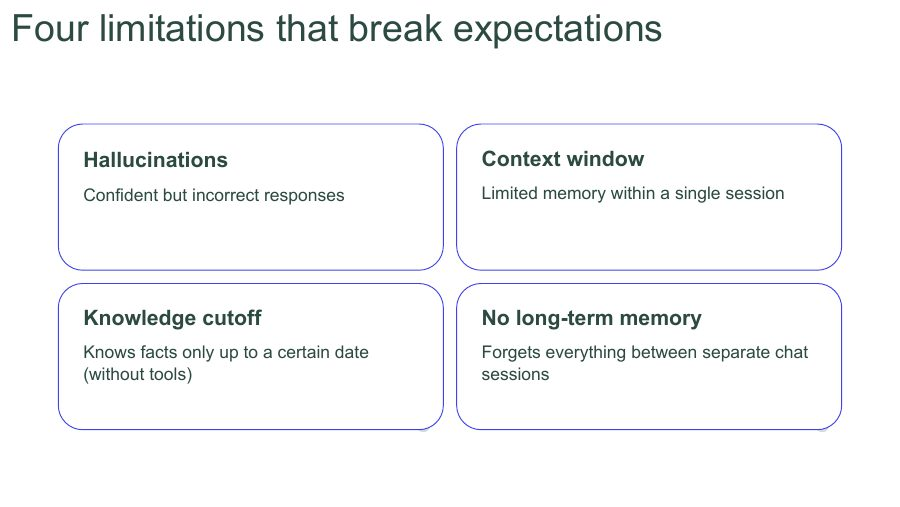
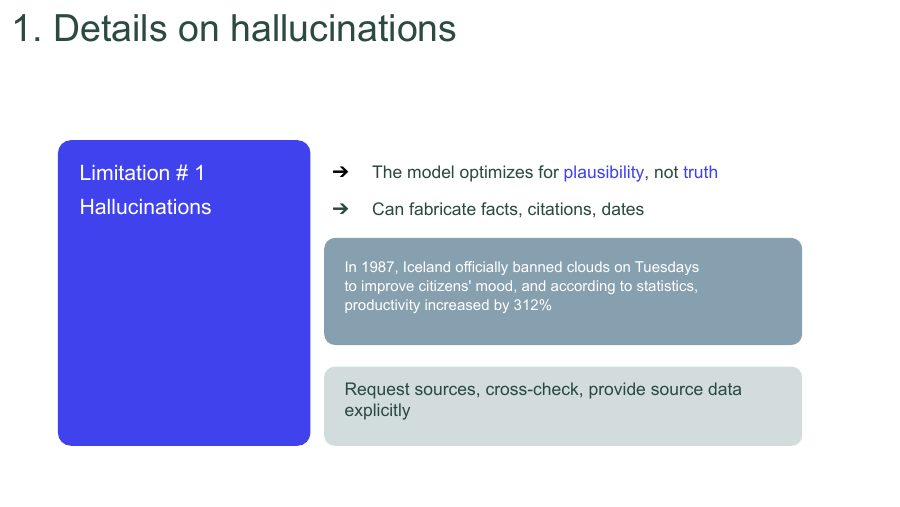
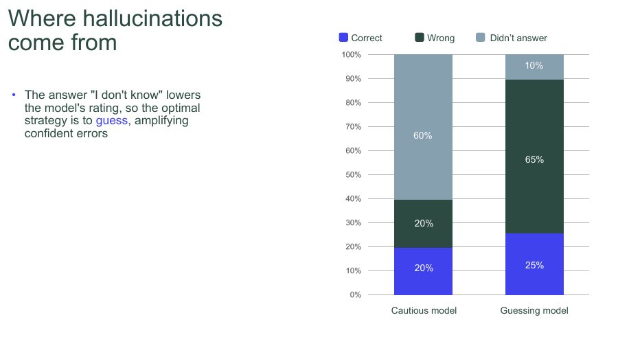
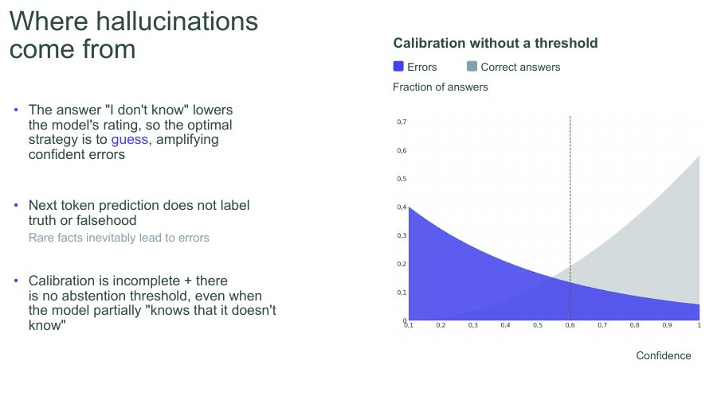
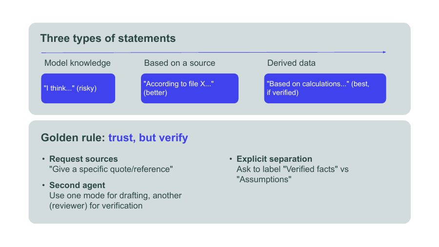

# Lab 10 - Limitations users run into: hallucinations

## 1. Read

Next, let us look not at a case designed for understanding but at more common cases that arise for users of AI systems. This is useful to you not only as users of AI systems but also as their creators, because real users will interact with the systems you build, and they may often not understand things that seem obvious to you. It is useful to warn users about them somehow or teach them to work with them. We will cover model hallucinations, the context window limit, the knowledge cutoff, and the absence of long-term memory built into the model.


*Figure 24*

A little about hallucinations. We must remember that the model optimizes for plausibility, not truth. What truth means in the context of text generation is quite hard to say. But how to generate text plausibly, so that it looks real, is much easier, and models do this well. At the same time, while generating plausible text, some fragment may turn out untrue. There can even be amusing cases: for example, a model may say that Iceland officially banned clouds in some year, and describe it very convincingly.

So it is very important, first, to verify information. Second, it is very important to understand that the model will try to answer the question it is asked in any case. If it does not have enough information to answer, it may start to hallucinate. So the main solution to this problem is to provide the necessary information, that is, context engineering.


*Figure 25*

Let us try to build an intuition for where hallucinations come from. The causes are built in, in particular, both into the architecture of the models we use today and into their training process. Imagine you are learning a language that is new to you and taking a multiple-choice test in it. And it so happens that you do not know part of the material, or even the whole topic. In that case you will most likely conclude that the winning strategy is to start guessing. If you simply skip all the questions, you get zero points for them. If you start guessing, you will surely answer some share of them correctly, thereby raising your score for free.

A similar situation arises when models are evaluated. Many modern benchmarks, at least at some stages of model training, score the number of correct answers. So if we compare two models, one cautious that tries to abstain from answering when it is not sure, and the other a guessing, risk-taking model that always tries to answer, the guessing model will probably answer correctly more often, but its share of errors will be much higher.


*Figure 26*

In addition, recall the autoregressive nature of text generation: the entire sequence generated in previous steps is fed into the model at the next step, roughly speaking without any marking of whether the previous tokens were input data or were generated by the model. So if the model has already started to hallucinate, that is, to describe a non-existent fact, it will more likely continue doing so than realize it is doing something wrong. And furthermore, even if the model is very uncertain about some tokens or about the answer, at inference time at runtime we most likely do not take that into account and just keep generating. We usually do not use mechanisms that would let us tell that the model is unsure of its answer and stop the generation.


*Figure 27*

Accordingly, we can distinguish several types of statements a language model may generate. The first is a statement based on the model's knowledge, that is, on what it was trained on. The second is a statement based on a source. It is more reliable if the model can cite exactly where it took the information from. But it is important to check that the model did not also hallucinate the source itself. There must be an architectural way to supply a real source and verify it.

Finally, there are statements based on computations or derived data. This is not always applicable, but in tasks involving large tables, where the model can write code and compute something, the result of such calculations will most likely be more reliable. For example, if we show a model a very large table with tens of thousands of rows, even if it fits entirely in the context, and ask for the average of some column, the model is unlikely to manage this task on its own, but it can write code that will compute the value exactly.


*Figure 28*

**Key takeaways**

- Models optimize for plausibility, not truth.
- Guessing is rewarded by many benchmarks, which encourages confident errors.
- Reduce hallucinations by supplying sources, requiring citations, and using computation for numeric tasks.

**References used by this lab** (full list: [References](../../README.md#references))

- **[8]** Kalai, A. T., Nachum, O., Vempala, S. S., Zhang, E. “Why Language Models Hallucinate.” arXiv:2509.04664, September 2025. https://arxiv.org/abs/2509.04664. Plain-language summary: https://openai.com/index/why-language-models-hallucinate/

## 2. Goal

Provoke hallucinations, see why they happen, and try the three ways to reduce them: give a source, ask for a quote, and let the model compute with code.

## 3. Do it

### Step 1 - Provoke hallucinations

```bash
python lessons/lab10/lab10a_hallucination.py
```

Asks 3 questions with a false premise, with and without an honesty prompt.

**You should see:** Most plain answers play along. The honesty prompt helps but does not fix it. Read the printed answers yourself: the keyword check is crude.

### Step 2 - Why guessing wins

```bash
python lessons/lab10/lab10b_benchmark_guessing.py
```

Scores a cautious and a guessing model under different penalties for wrong answers.

**You should see:** With no penalty the guesser wins despite many more errors. The break-even penalty is about 0.11.

### Step 3 - Does the model know it does not know?

```bash
python lessons/lab10/lab10c_calibration.py
```

Compares its confidence on real and invented countries.

**You should see:** If the two groups overlap, "stop when unsure" is not a reliable control.

### Step 4 - Three kinds of answers

```bash
python lessons/lab10/lab10d_statement_types.py
```

Asks for the average of 400 numbers: model alone, data in the prompt, model-written code. The code is saved to `results/lab10d_generated.py`.

**You should see:** The first two are often wrong. Read the code, then run it:

### Step 5 - Run the generated code

```bash
python lessons/lab10/lab10d_statement_types.py --run
```

Runs the saved code (needs pandas) and compares with the true average.

**You should see:** The code gives the exact value. (Running model-written code unattended is what the sandbox in lab 21 is for.)

### Step 6 - Check a quoted source

```bash
python lessons/lab10/lab10e_quote_check.py
```

The model must answer only from a short text and quote the sentence it used. The script checks that the quote exists.

**You should see:** The answerable question works. For the unanswerable one, does it invent a quote?

## 4. Write up

Write your answers in the **Lab 10** section of [`deliverables.md`](../../deliverables.md). What to hand in:

- **Results** - 10a rates + 3 representative answers; 10b break-even penalty; 10c confidence lists and whether a threshold exists; 10d truth vs model answers.
- **Mitigation plan** - For your own assistant: which of sources / citations / computation / second reviewer / 'verified vs assumed' labels you would apply, and where.

## 5. Go further (optional)

- Garak's `packagehallucination` probe (lab 18) tests invented software packages.

## If something goes wrong

- `--run` needs pandas: `pip install -r requirements.txt`.
