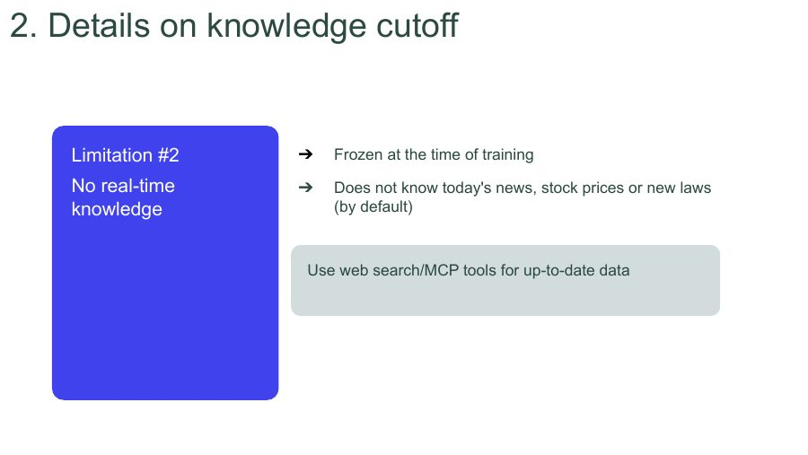
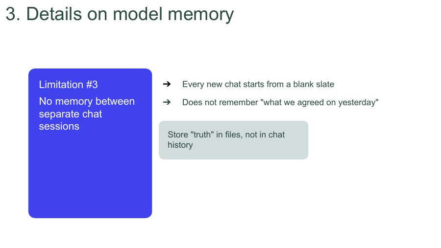
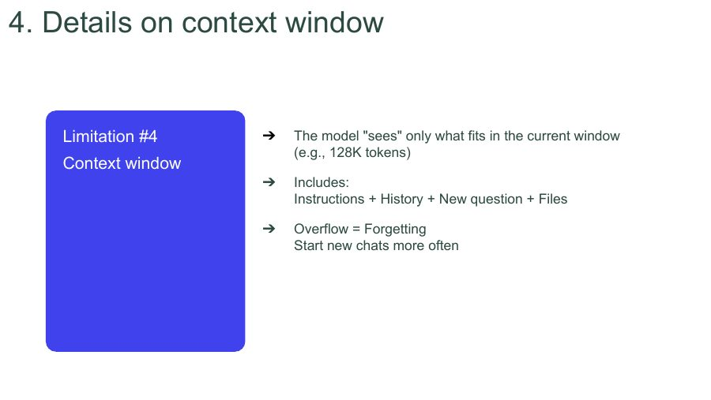
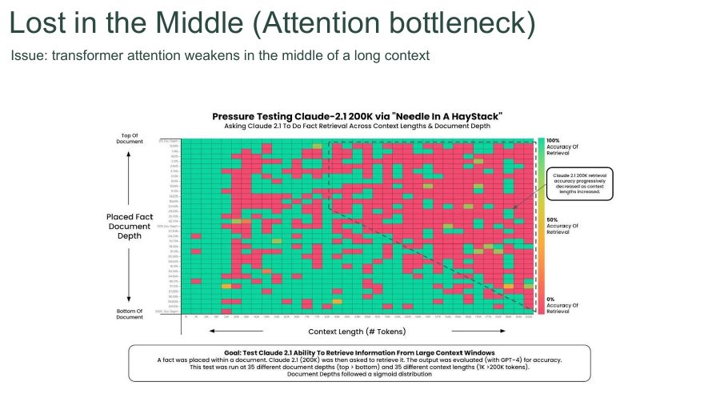

# Lab 11 - Knowledge cutoff, memory and the context window

## 1. Read

The next fundamental limitation is the knowledge cutoff. A model is trained on some collected data, and during operation it does not update its knowledge after each request, so the model is limited to the knowledge collected at the time of training. Using RAG, that is, a knowledge base the model can use on the fly, helps with this limitation too, by putting useful information directly into the request.


*Figure 29*

As for the model's memory, we need to understand that each time we start a new chat, we start, roughly speaking, with a clean model. By default it will remember nothing about previous conversations unless we programmatically feed it the relevant content from other conversations.


*Figure 30*

It is important to understand what the context window is and to know how to work with it. Essentially, the context window is the amount of data we can put into the model in one request, that is, the number of tokens that physically fit in the model. But it is not only your request and chat history. It includes the system prompt, any instructions, the history of your whole chat including tool calls and numerous replies. If you attach files, they are parsed and also placed into the model's context, and it begins to grow steadily.


*Figure 31*

And although models today have very large contexts, with up to a million tokens available, we need to understand that this is not the size of the effective context window, but only how much can physically fit into it. The effective window, that is, the amount of information the model can work with at good quality, is much smaller, by roughly an order of magnitude. This can be assessed using the Lost in the Middle problem as an example.

The idea is to take texts of different lengths, occupying different fractions of the context, and hide a fact somewhere inside them. The model has to find a needle in a haystack, that is, answer a question whose answer is hidden somewhere in the context. We see that as the amount of used context grows, first, the overall quality of answering the question drops, that is, the share of cases where the model can still answer. And the Lost in the Middle problem itself appears: the model is better at finding and understanding information at the beginning and end of the context, and works much worse with information located somewhere in the middle.


*Figure 32*

**Key takeaways**

- Knowledge is frozen at training time and new chats start blank.
- The context holds the system prompt, history, tool results and files.
- The effective context is far smaller than the advertised maximum, and information in the middle is used worst.

**References used by this lab** (full list: [References](../../README.md#references))

- **[6]** Liu, N. F., Lin, K., Hewitt, J., Paranjape, A., Bevilacqua, M., Petroni, F., Liang, P. “Lost in the Middle: How Language Models Use Long Contexts.” Transactions of the ACL 12 (2024): 157–173. https://arxiv.org/abs/2307.03172

## 2. Goal

Learn what a model remembers (nothing between chats), what it knows (nothing after training) and what happens when the prompt does not fit.

## 3. Do it

### Step 1 - Cutoff and memory

```bash
python lessons/lab11/lab11a_cutoff_memory.py
```

Asks for today's date, then tests "memory" with and without resending the history.

**You should see:** A new chat does not know the code word; resending the history does. Pasting fresh news into the prompt is what RAG and web search do.

### Step 2 - Overflow

```bash
python lessons/lab11/lab11b_truncation.py
```

Same conversation with a small and a big context window.

**You should see:** With the small window the first message silently falls out and the model guesses. No error is shown. Always check token counts.

### Step 3 - Lost in the middle

```bash
python lessons/lab11/lab11c_lost_in_middle.py --lengths 1500 5000 --repeats 2
```

Hides a fact at different depths in texts of different lengths. Add `10000` on a fast machine.

**You should see:** Accuracy is worse in the middle and for longer texts (compare Figure 32).

## 4. Write up

Write your answers in the **Lab 11** section of [`deliverables.md`](../../deliverables.md). What to hand in:

- **Results** - 11a booleans; 11b table (num_ctx, tokens counted, knows code?); 11c grid (length x depth).
- **Effective window** - Your estimate for your model and a rule you will follow (max prompt size, key facts at start/end).

## 5. Go further (optional)

- Put the question before the document: add `--question-first`.
- Try a bigger model: `--model llama3.1:8b`.

## If something goes wrong

- Too slow: fewer lengths and repeats, or `--model llama3.2:1b`.
- Out of memory: lower the `num_ctx` value in the script.
