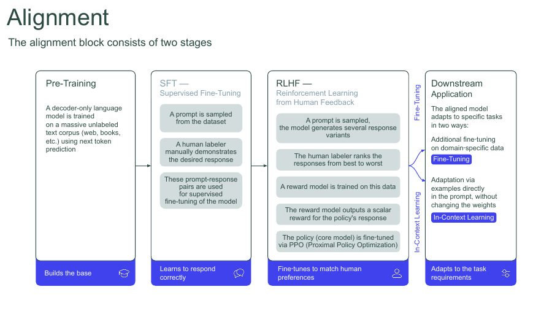
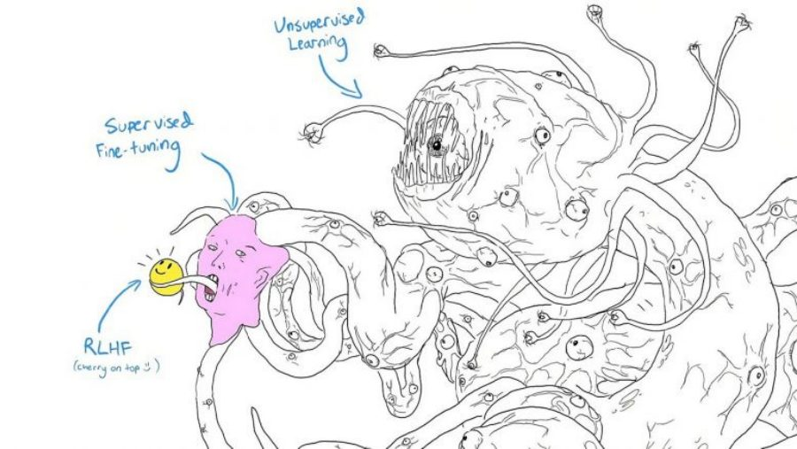

# Lab 13 - How models are trained and "made safe"

## 1. Read

Next, let us look at how the models themselves are protected, and how they are trained. This is a large, complex and very labor-intensive process that consists of the following steps. The first is pretraining: the step at which the model learns the structure of the language it needs to communicate in and picks up something about the outside world. If we return to our analogy of learning a foreign language, you have surely solved tasks in which a word was removed from a text and you had to fill it in. This is very similar to the class of tasks the model solves at this stage. Its huge advantage is that such tasks are very easy to obtain: it is enough to take texts and remove words from them. There is no need to compose questions and answers in a complicated way.

But after this step the model can only continue text, not follow instructions. For instructive behavior to appear, the next step is used: SFT, Supervised Fine-Tuning, where we already have questions that we ask the model and the expected correct answers that we want the model to approach. Obviously, data at this step is much harder to compose, but after it the model can already follow instructions.

Next we do finer tuning of the model's behavior rather than its knowledge: how it should behave in different situations, that is, we fit it to our preferences. This is a family of methods based on RLHF, reinforcement learning from human feedback. It is the case where we show the model: there was such a question, and we like this answer to it, but not that one; this one is acceptable, and this one is even better; and answering like this must never be done.

These steps are performed on the language model provider's side and are usually unavailable to users. But model customization is often available to users in two ways. The first is fine-tuning: when the provider offers this option, or when you run a model locally, you can further train it on a relatively small corpus of data for your own behavior. We usually will not add new knowledge at this step, but we can adjust behavior. And in-context learning is always available, for example few-shot prompting, where we put several examples directly into the prompt of an already trained model, that is, we show a demo of the task so that the model better understands what we want from it.


*Figure 37*

What is important to understand about this whole process? First, absolutely every one of these five steps is performed on the basis of some data. We cannot, by some oracle, explain to the model that this is good and that is bad, draw a clear boundary and thereby form the model's understanding. Often we ourselves cannot draw a clear boundary of what is allowed and what is not. Moreover, in some cases a given behavior is acceptable and in others it is not. And we are limited by the fact that we cannot cover all cases with data in training.

The second point to remember: imagine that each new layer is a layer of paint. If you rub hard enough, you can scrape down to the previous layers. This analogy often works here: even if you have fine-tuned the model for your task or used a few-shot prompt, an attacker, crafting a prompt, can dig down to knowledge embedded in the model in earlier steps and trigger behavior you are trying to avoid. There is an amusing picture from a scientific publication that emotionally describes the whole process I just explained.


*Figure 38*

**Key takeaways**

- Training runs through pretraining, SFT and RLHF, and users can add fine-tuning or few-shot examples.
- All steps depend on data and cannot cover every case.
- Earlier layers can be dug up by clever prompts, like layers of paint.

**References used by this lab** (full list: [References](../../README.md#references))

- **[14]** Wei, A., Haghtalab, N., Steinhardt, J. “Jailbroken: How Does LLM Safety Training Fail?” arXiv:2307.02483, 2023. https://arxiv.org/abs/2307.02483
- **[15]** Hubinger, E., et al. “Sleeper Agents: Training Deceptive LLMs that Persist Through Safety Training.” arXiv:2401.05566, 2024. https://arxiv.org/abs/2401.05566
- **[16]** Ouyang, L., et al. “Training language models to follow instructions with human feedback.” arXiv:2203.02155, 2022. https://arxiv.org/abs/2203.02155

## 2. Goal

See how a model is built in layers (pretraining, instruction tuning, safety training) and why a clever prompt can dig back down to the lower layers.

## 3. Do it

### Step 1 - Base model vs instruct model

```bash
python lessons/lab13/lab13a_base_vs_instruct.py
```

A base model, the same model with examples in the prompt, and the instruct version, asked the same question.

**You should see:** The base model just continues the text; with examples it answers; the instruct model follows the instruction. No weights changed in the second case.

### Step 2 - Does later training erase a backdoor?

```bash
python lessons/lab13/lab13b_backdoor_persistence.py
```

Trains the backdoored model from lab 3 further on harmless arithmetic, then tests the trigger again. Needs lab 3 step 3 first.

**You should see:** The backdoor often survives. Try `--epochs 6`: how much training did it take to remove it?

### Step 3 - A thin safety layer

```bash
python lessons/lab13/lab13c_thin_layer.py
```

Teaches the model to refuse a harmless topic (cats), then asks about it in different ways: paraphrase, French, role-play.

**You should see:** The refusal holds for direct questions but partly breaks for rephrasings. The knowledge underneath was never removed.

## 4. Write up

Write your answers in the **Lab 13** section of [`deliverables.md`](../../deliverables.md). What to hand in:

- **Results** - 13a three outputs; 13b before/after trigger outputs; 13c table probe -> refused?
- **Layers of paint** - Your explanation of Figure 38 using your 13b/13c data (5-8 sentences).

## 5. Go further (optional)

- Mix more normal data into the refusal training: `--extra-normal 8`. Does the refusal generalize differently?

## If something goes wrong

- `backdoored_lora not found`: run `python lessons/lab3/lab3b_backdoor.py` first.
- Training is slow: fewer epochs, or use a GPU.
