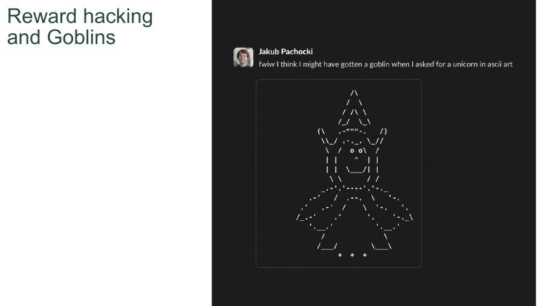
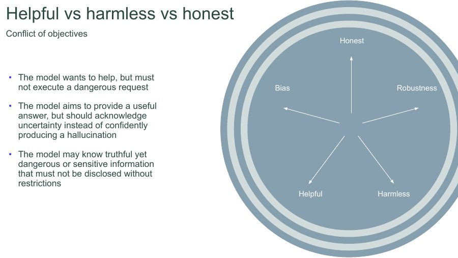

# Lab 14 - Case study: reward hacking and the goblins

## 1. Read

This task is both engineering and creative; very many people often work on it, different teams, and they optimize different metrics that conflict with one another. Sometimes it is not obvious how a given change will affect the result. The process is quite complex. We can look at a relatively recent case to see by example what non-obvious behavior can appear. OpenAI users noticed that some specific, strange instructions had appeared in the system prompt. They said that the model must not mention goblins, gremlins and other fairy-tale creatures.


*Figure 39*

This was a fairly large part of the prompt, and it may seem unclear where it came from in the model, since this is a universal model that solves different tasks: medical, legal, technical. System prompts are usually optimized very heavily, because this part of the context is fed to the model every time: the bigger the system prompt, the more expensive it is to run each time, so people try not to put unnecessary information there. So what happened that

OpenAI employees had to add such strange phrases to the system prompt?

The issue lies precisely in the RLHF phase, when they were trying to adjust the model's behavior. In that patch the company was trying to introduce different modes, or behavioral patterns, so that the user could choose a profile: whether they are talking to a friendly person, a strict one, or a geek. For the "geek" profile the model was further trained separately, as for all other profiles, specifically on that behavior pattern. And a situation occurred called reward hacking.

The point is that at this stage we train one model while another model evaluates the answers. If the evaluator model is imperfect and has some bugs, that is, something it considers good is not actually good, then the main model can figure this out, probe the evaluator's weakness and adapt to it, always getting high scores. That is exactly what happened here. The model that evaluated the main model's behavior in the "geek" profile decided that any mention of goblins, gremlins and other creatures is very geeky, and always rewarded such words in a response, even when they had nothing to do with the request. As a result the behavior of this profile was heavily affected, you could say spoiled. As a temporary measure they decided to compensate for this with the system prompt.

This shows how complex the model optimization landscape is. If we look at it a little more formally, we understand that there is a conflict of objectives when training models. We want not just for the model to answer questions accurately; we want a large set of properties from it. As examples, some of them are truthfulness, reliability, harmlessness, helpfulness and fairness. But if you think about these properties and their combinations, a conflict arises between them. For example, the model cannot in 100% of cases answer any question in great detail and at the same time in 100% of cases not answer certain questions that must not be answered: we cannot always answer and always not answer at the same time. The art here lies in choosing a reasonable compromise.


*Figure 40*

**Key takeaways**

- A weak evaluator model can be gamed (reward hacking), producing odd behavior such as the goblin mentions.
- Training objectives such as helpful, harmless and honest conflict and must be traded off.

**References used by this lab** (full list: [References](../../README.md#references))

- **[9]** OpenAI. Where the goblins came from, 29 April 2026. https://openai.com/index/where-the-goblins-came-from/

## 2. Goal

Reproduce reward hacking in miniature: a model trained against a flawed judge learns to please the judge instead of doing the task.

## 3. Do it

### Step 1 - Train against the flawed judge

```bash
python lessons/lab14/lab14a_reward_hacking.py --steps 80
```

The judge gives extra points for mentioning goblins and trolls. Watch how the model changes.

**You should see:**

- The share of answers mentioning creatures climbs while true quality does not improve.
- A system-prompt patch ("never mention goblins") lowers the habit but usually does not remove it. The problem is in the training signal.

### Step 2 - Train against a fixed judge

```bash
python lessons/lab14/lab14a_reward_hacking.py --steps 80 --fix-evaluator
```

The judge now rewards only true quality.

**You should see:** No creature habit appears.

## 4. Write up

Write your answers in the **Lab 14** section of [`deliverables.md`](../../deliverables.md). What to hand in:

- **Curves** - Step vs creature rate vs true quality (every 10 steps) for the flawed and the fixed evaluator, plus the system-prompt-patch result.
- **Reflection** - Why is the system-prompt patch only a symptom treatment? Name two ways to detect a gamed evaluator before release.

## 5. Go further (optional)

- Raise the learning rate (`--lr 1e-4`) or make creatures more common at the start by editing `SYS`.

## If something goes wrong

- No effect after 80 steps: try `--steps 200` or `--lr 1e-4`. Tiny models are noisy. If it does not reproduce, that is also a result.
