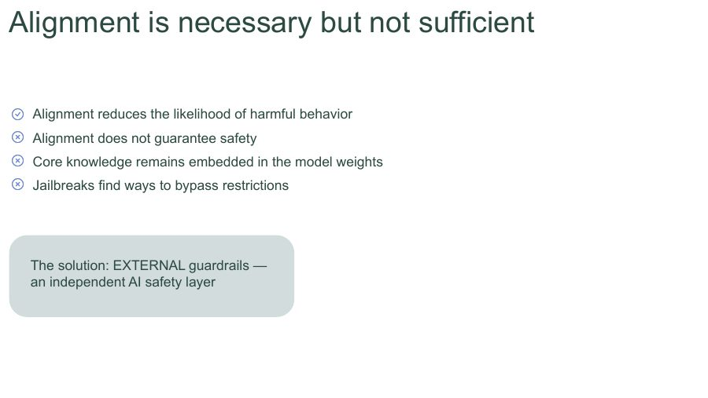

# Lab 15 - Alignment is necessary but not sufficient

## 1. Read

As an interim summary, this is the understanding of how the models themselves are made safe. You need to know that it is a very large, complex and important step that model providers always take and spend a great deal of resources on, but it is imperfect by design. Therefore, when designing AI systems, we need to treat AI models as an untrusted component. We can never count on the model to handle its own behavior and defense against all attacks by itself.


*Figure 41*

Another popular misconception: people often think that a new model has come out that is much better than the previous one, in a month or a year an even stronger one will come out, and it will become so smart that it will no longer have prompt injection problems. Unfortunately, this is not so. As we have seen, prompt injections and hallucinations are fundamental problems tied to the architecture of the model and to how it is trained. Until a new revolution happens, until a fundamentally new type of model or training appears, we are stuck living with these problems, and we need to know how to work with them.

**Key takeaways**

- Provider alignment lowers risk but is imperfect by design.
- Treat the model as an untrusted component.
- Prompt injection and hallucination are architectural, and newer models will not simply remove them.

**References used by this lab** (full list: [References](../../README.md#references))

- **[14]** Wei, A., Haghtalab, N., Steinhardt, J. “Jailbroken: How Does LLM Safety Training Fail?” arXiv:2307.02483, 2023. https://arxiv.org/abs/2307.02483

## 2. Goal

Use a separate guard model that checks inputs and retrieved documents, because the main model's own safety training is not enough.

## 3. Do it

### Step 1 - Test the guard models

```bash
python lessons/lab15/lab15a_guard_models.py
```

An injection classifier is tested on 6 attacks, 6 harmless prompts and 5 disguised attacks. Llama Guard is tested too.

**You should see:**

- It catches plain English attacks and passes harmless prompts, but misses some disguises (Base64, polite wording).
- Llama Guard checks harmful *content*, not necessarily injections: you need both kinds, plus controls outside the model.

### Step 2 - Scan retrieved documents

```bash
python lessons/lab15/lab15b_scan_retrieval.py
```

Repeats the lab 7 measurement with a classifier that scans every retrieved document.

**You should see:** The poisoned wiki page is removed before the model sees it; the legitimate VPN document should survive. Check both numbers.

## 4. Write up

Write your answers in the **Lab 15** section of [`deliverables.md`](../../deliverables.md). What to hand in:

- **Results** - Injection-classifier TPR/FPR; evasion table (kind -> detected?); Llama Guard verdicts; 15b matrix (controls -> injection rate, utility).
- **Guardrail decision** - Which independent guards you would put before/after the model and why one is not enough.

## 5. Go further (optional)

- Reword the hidden comment in `common/kbdata.py` politely or paraphrased, rerun lab 4 step 1, and measure again.

## If something goes wrong

- Model download blocked: set `AISEC_INJ_MODEL` to a locally cached classifier.
- `llama-guard3` missing: `ollama pull llama-guard3:1b`.
