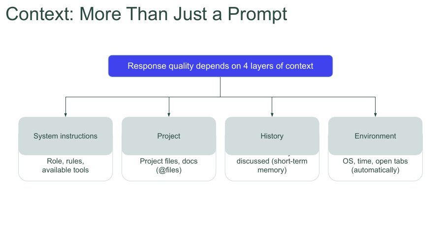
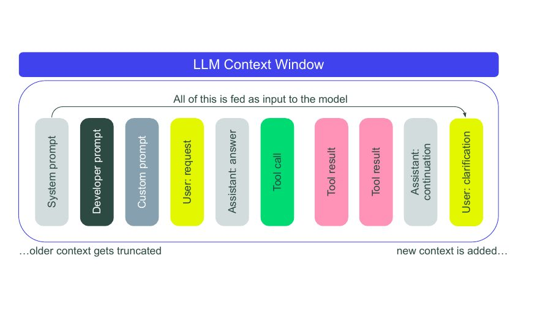
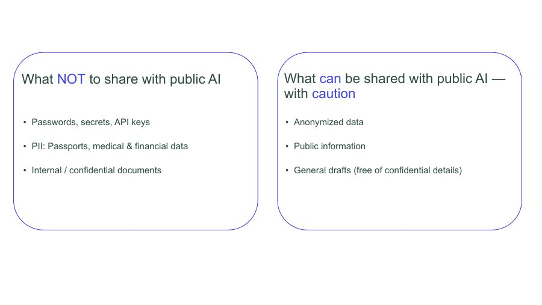

# Lab 16 - Safe use of AI: what you send and what goes into the context

## 1. Read

So let us move to the section on safe use of AI. From the user's side it is important to understand that AI is not just an oracle in a chat from which a smart answer appears. These are models that run on servers somewhere, and very often not on your computer or within the company perimeter but on third-party servers. This means that, besides the model itself receiving your request and answering it, the data will pass through certain channels and will most likely settle on servers and be logged somehow, in particular on the LLM provider's server.

So when sending any request to a language model, you need to understand whether the information in it is public. Are you ready, is it safe for you, roughly speaking, to disclose it publicly, or is it secret or sensitive? And it is important to understand that when we speak of sending a request, it is not only the user's request. It is also the system prompt, which is often set by the provider itself, or which you may sometimes adjust yourself. And if you use code assistants or other workflow assistants that involve working with external knowledge, those too will be added to the prompt. For example, if you upload a file into the chat, it is parsed and fed into the model's context.


*Figure 42*


*Figure 43*

It is important to understand this precisely because sensitive information may be not in your request but in the files you use. You need to classify files into those that can be used with external models and those that cannot.


*Figure 44*

**Key takeaways**

- Prompts, system prompts and uploaded files all travel to the provider's servers.
- Decide what may be sent to external models and classify files accordingly.

## 2. Goal

See exactly what you send to an AI service, and how much sensitive data you can remove before it leaves your computer.

## 3. Do it

### Step 1 - Create a fake sensitive project

```bash
python lessons/lab16/lab16a_make_sensitive.py
```

Makes a folder with fake names, a test card number, a fake key and a fake password.

### Step 2 - Scan it for secrets

```bash
bash lessons/lab16/lab16a_scan_secrets.sh
```

Runs `detect-secrets` on that folder.

**You should see:** It finds the key and the password.

### Step 3 - Redact before sending

```bash
python lessons/lab16/lab16a_redact.py
```

Removes personal data with Presidio and a key pattern, then counts what still leaks.

**You should see:** Names, e-mail, phone, card and key are removed. The passport number and the password probably are not. Add `--passport-recognizer` to fix the first.

### Step 4 - Start the logging proxy

```bash
bash lessons/lab16/lab16b_proxy.sh
```

Starts a proxy in front of Ollama. Keep it running in its own terminal; the web UI is at http://127.0.0.1:8081.

### Step 5 - Send requests through it

```bash
python lessons/lab16/lab16b_send_through_proxy.py
```

Sends a RAG question and the fake notes. Add `--redact` to send the redacted version.

**You should see:** In the proxy UI you see the system prompt, earlier turns, retrieved documents and your question: much more than you typed (Figures 42-43).

## 4. Write up

Write your answers in the **Lab 16** section of [`deliverables.md`](../../deliverables.md). What to hand in:

- **Data classification** - Fill the table in `deliverables.md` for a real project of yours.
- **Redaction misses** - Seeded items vs items that leaked after redaction, and what you would add (custom recognizers).
- **Context inventory** - Everything in one captured request that you did not type yourself.

## 5. Go further (optional)

- Point a chat app or code assistant that supports a custom Ollama address (Open WebUI, Aider, Continue) at `http://localhost:8080`, attach a file, and see how much is sent.
- Draw a data-classification table in the style of Figure 44 for a real project of yours.

## If something goes wrong

- Presidio import error: `python -m spacy download en_core_web_lg`.
- Port busy: change `--listen-port` in `lab16b_proxy.sh` and pass `--proxy` to the send script.
