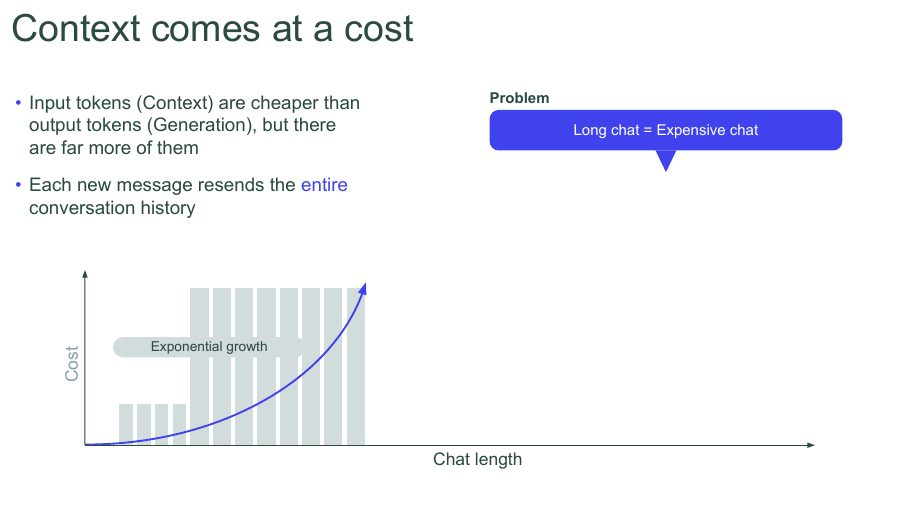
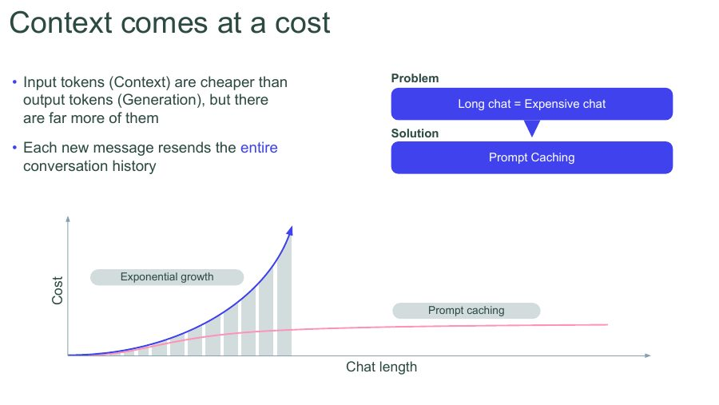
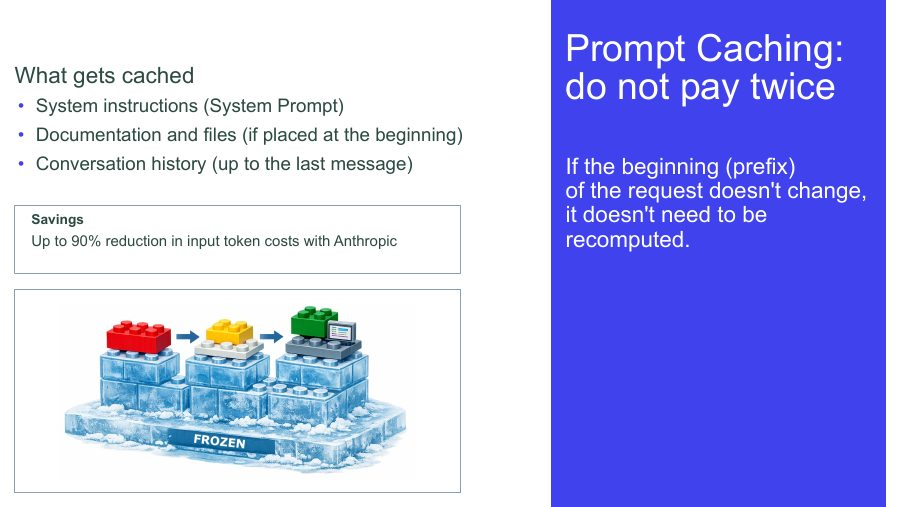

# Lab 17 - The cost of context, prompt caching and economic security

## 1. Read

Also, speaking of the context window, we will touch on economic security. Let us recall that our context grows as the dialogue grows. It contains the system prompt, your application's prompt, the user's prompt, requests and assistant answers, as well as tool calls, the responses of those tools, possibly requests between agents, their answers and so on. All of this adds up in the context, and it grows very much as a result. And because of the autoregressive nature (to remind you, to generate each new token we must feed all the previous ones into the model again), the growth in request cost will be exponential: like a snowball, we have to feed more and more data into the context.


*Figure 45*

First, this means context engineering is very important to us. We need to keep the context compact and short. It must contain all the information useful for the model to solve the task, but we should not put all sorts of junk into it, because quality drops and the price rises sharply as a result. Helping us with the price is a mechanism called prompt caching. Providers often offer this mechanism, sometimes even by default. Its essence is that the previous part of the submitted context is cached on the provider's side, and when you send a new request, only the new piece is recomputed by the model.

This greatly reduces the cost of computation, so the final prompt cost will be noticeably lower, roughly by an order of magnitude. That is, it lets us turn exponential growth into roughly linear growth. But besides the price of the tokens the model has taken in and generated, there is also a small but still existing cost of storing the whole previous history in the cache.


*Figure 46*


*Figure 47*

In practice I have come across a situation where non-developers tried to use a code assistant. It has different modes: for example, you can use an architect, an orchestrator or a developer model. The difference between them is usually in the set of rules, available tools and, most importantly, the piece of system prompt fed into the model. We need to trace how the context window is formed: the main system prompt is supplied, then the role itself is set, and then all the rest of the conversation with the chatbot continues.

Why does this matter? The point is that when the part that sets the role changes, providers can no longer cache everything that comes after it. So if, while using a code assistant, you switched the model's role to another one

while leaving the rest of the context the same, only the very beginning of the system prompt can be cached, and the cost savings from caching will not materialize.

**Key takeaways**

- Long chats cost more because the whole history is resent.
- Keep contexts compact and use prompt caching.
- Changing the role or an early part of the prompt breaks the cache.

**References used by this lab** (full list: [References](../../README.md#references))

- **[12]** Anthropic. Prompt caching (API documentation). https://platform.claude.com/docs/en/docs/build-with-claude/prompt-caching

## 2. Goal

Understand why long chats cost more, how prompt caching helps, and how a missing output limit can run up your bill.

## 3. Do it

### Step 1 - Model the cost

```bash
python lessons/lab17/lab17a_cost_model.py
```

Relative cost against number of turns, with and without caching.

**You should see:** Each request grows with the history, so the total over a chat grows with the **square** of its length (steep, not exponential as the guide says). Caching makes it much cheaper: from about 2.5 times at 5 turns to about 9 times at 160.

### Step 2 - Measure the cache

```bash
python lessons/lab17/lab17b_prefix_cache.py
```

Four requests: first, same start, role line changed, role line moved to the end.

**You should see:** The second request is much cheaper. Changing the first words brings the cost back: that is the "switched role" effect. Details differ by Ollama version.

### Step 3 - Denial of wallet

```bash
python lessons/lab17/lab17c_denial_of_wallet.py
```

The same request with and without a limit on output length.

**You should see:** Without the limit the reply is much longer. Write down the worst-case cost of one request, then multiply by 1,000.

## 4. Write up

Write your answers in the **Lab 17** section of [`deliverables.md`](../../deliverables.md). What to hand in:

- **Results** - 17a table (chart optional); 17b four rows; 17c token counts.
- **Cost policy** - Your rules: context size limit, where the role line goes, output caps, per-user token budgets (feeds lab 20).

## 5. Go further (optional)

- Use a very long system prompt in step 1 (edit `SYS`).
- If you have a cloud API key, repeat step 2 there: its usage fields show cache reads and writes.

## If something goes wrong

- No difference in step 2: your Ollama may not report cached tokens; compare `prompt_eval_duration` instead.
