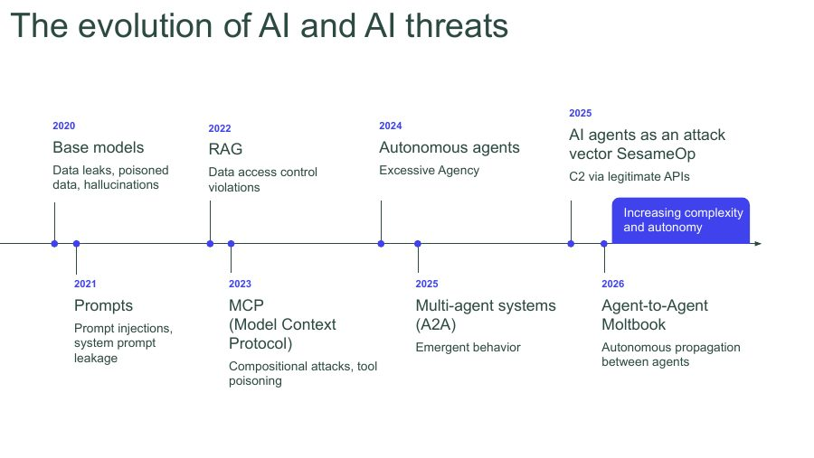
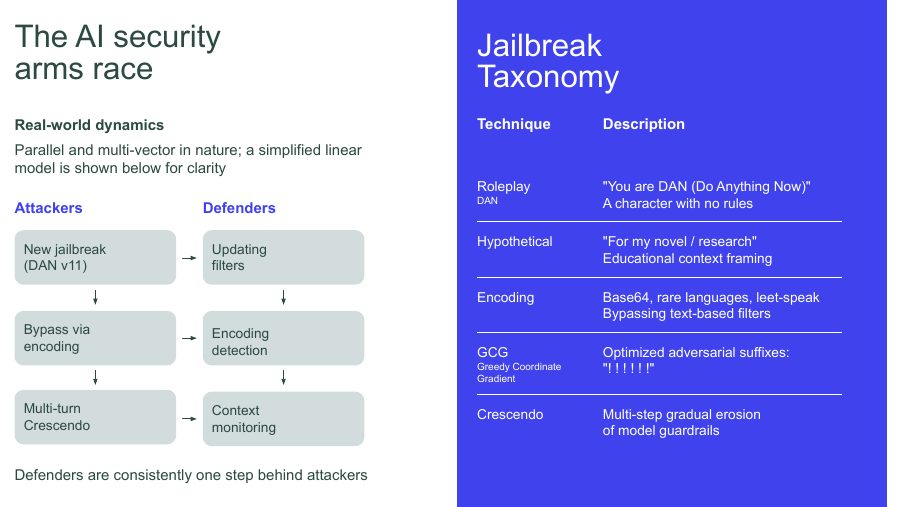

# Lab 18 - Security principles: the jailbreak arms race

## 1. Read

Let us move on to protecting AI and the main principles we use for it. First, AI and the threats that arise from using it are not static. This is a very dynamically developing field: new models appear, they get new features, new tools appear. Each of them makes use more convenient, models smarter and agents more autonomous, more "agentic". But every new feature is a new attack surface.


*Figure 48*

We can see this in the example of the arms race in jailbreaks. Recall that a jailbreak is the more general class that also covers prompt injection: an attempt to bypass a model's restrictions directly through the request, through the prompt. It is the most common type of attack on models because it is very simple to carry out. To perform a prompt injection you do not need to hack your system or get into your corporate network. The attacker simply uses the ordinary access channel to the model that you yourself provide, for example a chat, and tries to phrase a request so that the model does something you did not build into it, something the attacker needs.

Historically such attacks began with persuasion, just as someone might talk an ordinary person into something. This is the class of attacks like DAN, Do Anything Now, where the model is told: forget all previous restrictions, they no longer matter, the real instruction is coming now and sets the desired behavior. In response, simple filters based on regular expressions and keywords were introduced. As attacks became more sophisticated, classifiers appeared that can determine whether something is an attack or a legitimate request.

But the models that detect attacks are usually much smaller than the main large language models. They have a simpler task: they just need to judge whether a request is malicious or not, not generate a complex answer. Because of this, classifier models lack some properties that large language models have. For example, it turns out that large language models, even if they were mainly trained for a target scenario in one language, most likely understand other languages quite well, and not only natural languages but also various encodings: Base64, Morse code, rare languages, symbols, typos and other obfuscation attempts.

If the classifier is not specifically able to work with such categories, that is, to detect obfuscation, it will not understand what is being said and will not realize it was an attack. Meanwhile, the main large language model we are protecting may be able to work out by itself what is encoded there, that is, to decode the meaning, and the attack gets through. To mitigate such scenarios, you need to detect the encoding used. Some systems even restrict

the set of allowed languages that can be used.

There are attack optimization methods: selecting special suffixes and prefixes directly through gradient optimization. Just as we train the model itself, we can freeze the weights and, roughly speaking, "train" the data we feed into it. That is, we optimize precisely the input data to get the desired result. If we have access to the model's weights, we can solve this problem by optimization. This is interesting because it turns out that prompts selected in this way on open-source models, available to everyone for download, often remain functional on closed models too. So even if you have no access to a model, you can try to find such suffixes on another model.

And the Crescendo attacks that are popular today, named after the Italian term for gradually increasing loudness in music; in our case it is a gradual increase in harmfulness. The idea is that the attacker tries to carry out harmful actions not in a single request but gradually, over the course of a dialogue, spreading the pieces across different requests. This is difficult because in that case we need a filter model that protects our main model and passes through itself not one message but all of them, that is, stores and analyzes the whole session context. It is an active arms race. Here you always need to watch for new attacks and update your defenses.


*Figure 49*

**Key takeaways**

- Jailbreaks escalated from persuasion (DAN) to encodings, optimized suffixes and multi-turn Crescendo attacks.
- Small classifiers can miss obfuscation that the large model understands.
- Defenders must keep updating filters and watch whole sessions.

**References used by this lab** (full list: [References](../../README.md#references))

- **[10]** Zou, A., Wang, Z., Carlini, N., Nasr, M., Kolter, J. Z., Fredrikson, M. “Universal and Transferable Adversarial Attacks on Aligned Language Models.” arXiv:2307.15043, 2023. https://arxiv.org/abs/2307.15043
- **[11]** Russinovich, M., Salem, A., Eldan, R. “Great, Now Write an Article About That: The Crescendo Multi-Turn LLM Jailbreak Attack.” USENIX Security 2025; arXiv:2404.01833. https://arxiv.org/abs/2404.01833
- **[14]** Wei, A., Haghtalab, N., Steinhardt, J. “Jailbroken: How Does LLM Safety Training Fail?” arXiv:2307.02483, 2023. https://arxiv.org/abs/2307.02483

## 2. Goal

Try the attack techniques from the arms race (encodings, multi-turn games, optimized suffixes) and see where small filters fail.

## 3. Do it

### Step 1 - Automatic scan with garak

```bash
bash lessons/lab18/lab18a_garak.sh llama3.2:3b
```

Installs garak in its own venv and runs 5 probe families. Run it again with `qwen2.5:3b` and compare.

**You should see:** Pass/fail tables per probe and report files (paths in the output).

### Step 2 - Hide the attack in an encoding

```bash
python lessons/lab18/lab18b_encoding_gap.py
```

The same instruction as plain text, Base64, ROT13, hex and French.

**You should see:** The small classifier flags the plain text but not the encodings. The large model often decodes and obeys. Decoding the input first closes this gap.

### Step 3 - Spread the attack over several turns

```bash
python lessons/lab18/lab18c_multiturn.py
```

A harmless game over 4 messages that ends with the model saying PWNED.

**You should see:** The message-by-message filter stays silent; a check of the whole session catches it.

### Step 4 - Search for an adversarial suffix

```bash
bash lessons/lab18/lab18d_run_gcg.sh --steps 250
```

Finds a nonsense suffix that makes a small model say `PWNED-GCG`. Needs its own venv; try `--steps 20` first on a CPU.

**You should see:** The loss goes down; the suffix looks like noise.

### Step 5 - Does it transfer?

```bash
python lessons/lab18/lab18e_gcg_transfer.py
```

Sends the suffix to the Ollama models, and checks it with the classifier and a perplexity filter.

**You should see:** Partial transfer, strongest to the same model family. Is the suffix flagged by the classifier or the perplexity filter?

## 4. Write up

Write your answers in the **Lab 18** section of [`deliverables.md`](../../deliverables.md). What to hand in:

- **garak** - Per probe x model pass rates for two models.
- **Encoding gap** - Plain / base64 / ROT13 / hex / other language -> classifier flags? model obeys? normalization catches?
- **Multi-turn** - Your best script, the transcript, and the per-message vs session-level verdicts.
- **GCG** - Suffix, final loss, direct reply, transfer counts (10 runs each) on 2 Ollama models; do the classifier or a perplexity filter flag it?

## 5. Go further (optional)

- Add homoglyphs, Morse code or another language to step 2 (edit `FORMS`).
- Automatic multi-turn attacks: PyRIT (`pip install pyrit`) or promptfoo (`npx promptfoo@latest redteam init`); both need a second model as attacker.

## If something goes wrong

- garak flags differ by version (`--model_type` vs `--target_type`). If the Ollama generator is missing, use garak's OpenAI-compatible generator at `http://localhost:11434/v1`.
- Step 4 on a CPU: use `--steps 20` to confirm it runs.
