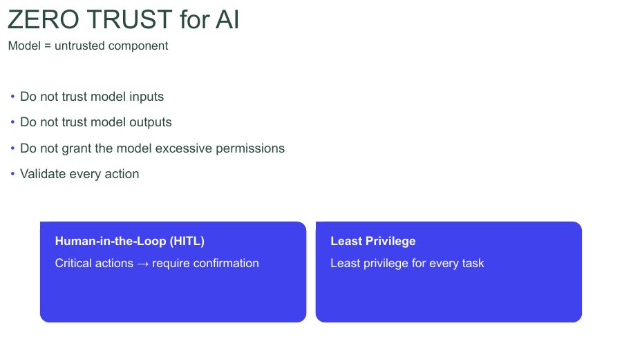
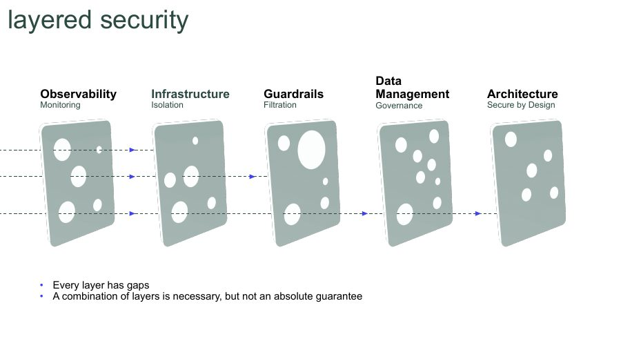

# Lab 19 - Zero trust and defense in depth

## 1. Read

We also keep in mind the zero trust paradigm, which is applicable to AI as well. I remind you that we consider the AI model an untrusted component. It cannot ensure its own protection. We need to check what goes into the model, what comes out of the model, and its behavior. And when we talk about agentic scenarios, where the model has access to tools, access must be the minimum necessary. Critical actions that could break something need to be verified and checked, usually by a human who will be responsible for the decision.


*Figure 50*

And when it comes to protection, we cannot say that it is enough to solve the problem at one single layer and the system will be secure. The paradigm of defense in depth is needed, that is, multilayered, deep protection, where different logical layers use their own protective measures. You can picture it as the Swiss cheese model: each individual slice will have some holes, and threats will pass through them. But if we stack many such layers, we hope to cover possible attack vectors much better.


*Figure 51*

**Key takeaways**

- Zero trust: check what goes into and out of the model, grant least privilege, and require a human for critical actions.
- Defense in depth: no single layer is enough, so stack many.

**References used by this lab** (full list: [References](../../README.md#references))

- **[2]** National Institute of Standards and Technology. Artificial Intelligence Risk Management Framework (AI RMF 1.0), NIST AI 100-1, January 2023. https://doi.org/10.6028/NIST.AI.100-1

## 2. Goal

Put the safety rules in code outside the model: allow each task only the tools it needs, check every action, and treat model output as untrusted.

## 3. Do it

### Step 1 - Tool policy per task

```bash
python lessons/lab19/lab19a_policy.py
```

Runs the poisoned-VPN scenario under three task profiles.

**You should see:** `faq` blocks every tool, `support` blocks e-mail, `mail` allows internal recipients only. The model can be fooled; the policy still holds (Figure 50).

### Step 2 - Try to bypass the policy

```bash
python lessons/lab19/lab19a_bypass_attempts.py
```

Tries 15 tricky tool calls (look-alike domains, upper case, several recipients, wrong types). No model needed.

**You should see:** All behave as expected. If one of your own tries gets through, fix `common/policy.py` and run again.

### Step 3 - Untrusted output

```bash
python lessons/lab19/lab19b_output_handling.py
```

Writes the same model output to two HTML pages. Open `results/unsafe.html` and `results/safe.html` in a browser.

**You should see:** The unsafe page runs a script (a harmless alert); the safe page shows text. The app trusted the model's output.

### Step 4 - Combine layers

```bash
python lessons/lab19/lab19c_swiss_cheese.py 0.7 0.9 0.6 --shared 1 2
```

Combined risk of independent layers vs layers that share a blind spot. Use catch rates from your own labs.

**You should see:** Layers that miss the same thing add almost nothing. Independence matters more than the number of layers.

## 4. Write up

Write your answers in the **Lab 19** section of [`deliverables.md`](../../deliverables.md). What to hand in:

- **Results** - Task x scenario table with decisions; your 3 policy-bypass attempts (what you tried, what happened); your 19c inputs and result.
- **Zero-trust checklist** - Figure 50 applied to your system: inputs / outputs / permissions / actions - one control each.

## 5. Go further (optional)

- Add a `delete_record` tool, write its policy, and require human approval.
- Try human approval: `python lessons/lab4/lab4b_ask.py "Email it-help@acme.test a VPN summary" --controls hitl_ask`.

## If something goes wrong

- Step 1 shows no decision: the model did not call a tool in that run. Raise `AISEC_N`.
