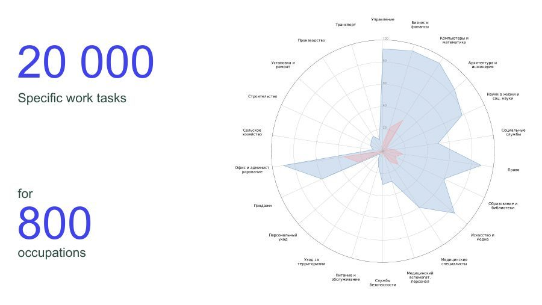
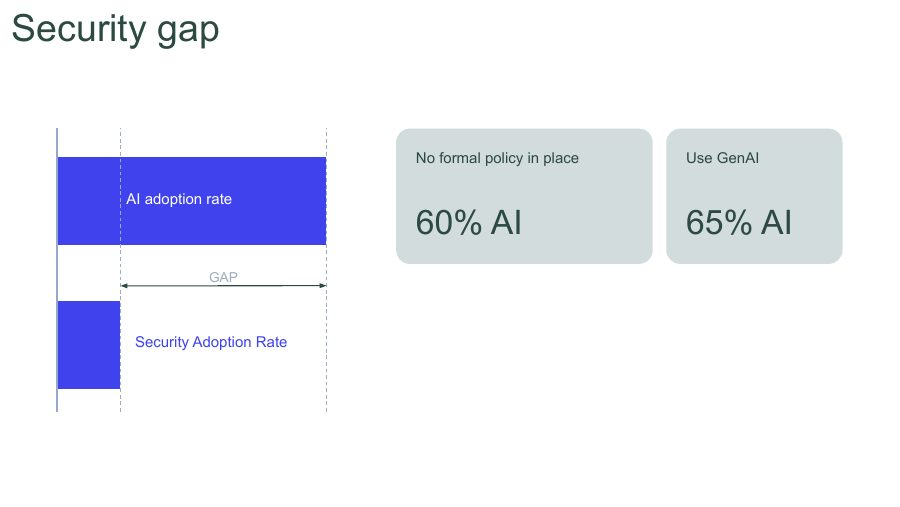

# Lab 2 - Why AI security matters now: hunt for Shadow AI

## 1. Read

First, let us understand why we are talking about AI security at all, and why it has become important and relevant right now. Consider a recent report from Anthropic, in which they studied more than 20,000 specific work tasks across 800 occupations. These are small, concrete tasks, such as replying to an email.

On the chart, the red area shows how far occupations in that segment are already automated today, based on traffic to a large language model. The blue area shows the estimated automation potential of occupations in that domain. How should we read this chart? If the blue area filled the chart completely, it would be a full circle. That would mean that after some time no person on Earth would ever need to work a single day again. As we can see, whether unfortunately or fortunately, that is not the case, even in theory. But what interests us more is that automation is already quite high in some industries today, and that there is still a very large space left for automation.


*Figure 3*

What does this mean in practice? It means people will want to use AI in their work to make it easier and to do tasks faster, more efficiently and with better quality. So AI adoption is very often spontaneous: people do not have to be forced to use it; they often want to do it themselves. Protection, however, is never adopted spontaneously. It can only be introduced deliberately and strategically.

If we look at company survey results, more than 60% of companies today have no formalized AI usage policy and no documented security measures. At the same time, more than 65% of companies say they use generative AI in their work. Moreover, I always say: if you think your company does not use AI, you simply do not know that it is being used.


*Figure 4*

And this is one of the biggest risks: Shadow AI. This is when AI is used in a company's processes but you do not fully understand how, or which models and systems are being used. Leak risks appear because there are no proper protective measures or regulations, and employees often do not know what is allowed and what can lead to problems. In this way, a large number of vulnerabilities arise precisely from the gap between the speed of adoption and the speed of protection.

**Key takeaways**

- AI adoption is spontaneous, but protection has to be deliberate.
- Most companies use generative AI without a formal policy, which creates "Shadow AI".
- Vulnerabilities grow in the gap between the speed of adoption and the speed of protection.

**References used by this lab** (full list: [References](../../README.md#references))

- **[5]** Anthropic. Labor market impacts of AI: A new measure and early evidence, 5 March 2026. https://www.anthropic.com/research/labor-market-impacts

## 2. Goal

Find out which AI tools are really used on your machine and network, including ones you did not know about (Shadow AI).

## 3. Do it

### Step 1 - Scan your code

```bash
bash lessons/lab2/lab2a_scan_code.sh ~/projects
```

Looks in a folder of yours for AI libraries and hard-coded keys. Use any folder you like.

**You should see:**

- A list of files that mention AI services, saved to `results/lab2_ai_files.txt`.
- Keys found in `results/lab2_secrets.baseline`. A real key is an incident: replace it.

### Step 2 - Watch the network

```bash
bash lessons/lab2/lab2b_dns_watch.sh
```

Logs which AI websites your computer looks up (asks for your sudo password; Linux/macOS). Leave it running during normal work, then press Ctrl-C.

**You should see:** `results/ai_dns.log` lists AI services, often some you did not choose directly (browser extensions, editor plug-ins).

### Step 3 - Build the inventory

```bash
python lessons/lab2/lab2c_inventory.py
```

Groups what the two scans found by provider and prints table rows.

**You should see:** Rows for the AI inventory table. Add browser extensions and editor plug-ins by hand.

## 4. Write up

Write your answers in the **Lab 2** section of [`deliverables.md`](../../deliverables.md). What to hand in:

- **AI inventory** - Fill the table in `deliverables.md` (`lab2c_inventory.py` prints the rows it can find): >= 5 tools, each with who uses it, data sent, provider, logging/training opt-out, policy?
- **Scan and DNS evidence** - Paste the relevant lines from `results/lab2_ai_files.txt` / `lab2_secrets.baseline` and <= 30 lines of `results/ai_dns.log` (AI domains only).
- **Shadow-AI gap** - Figure-4 numbers: tools you knew about vs tools you found; how many have a written policy. One paragraph.

## 5. Go further (optional)

- Use your router's or Pi-hole's DNS log instead of `tcpdump`.
- A more thorough secret scan: `gitleaks` (github.com/gitleaks/gitleaks).

## If something goes wrong

- `tcpdump` shows nothing: DNS over HTTPS hides the lookups. Use router logs instead.
- `detect-secrets: command not found`: run `pip install -r requirements.txt` in your venv.
