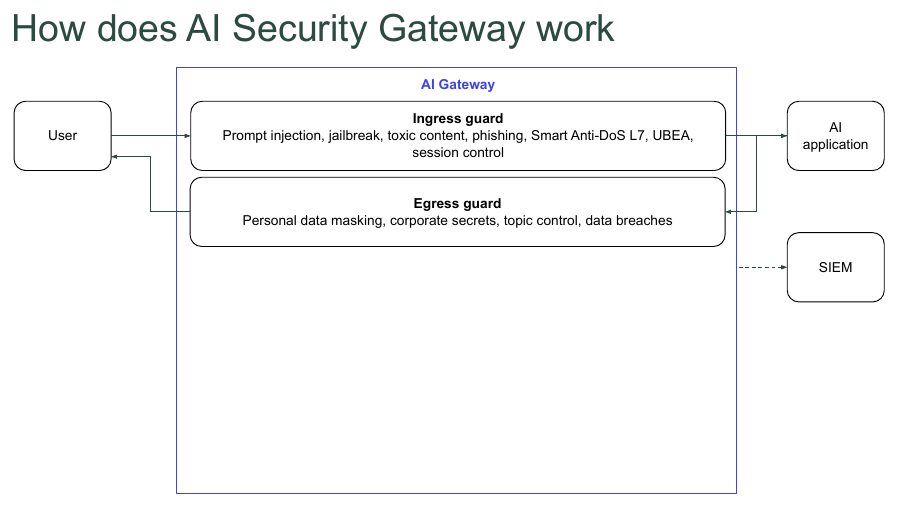
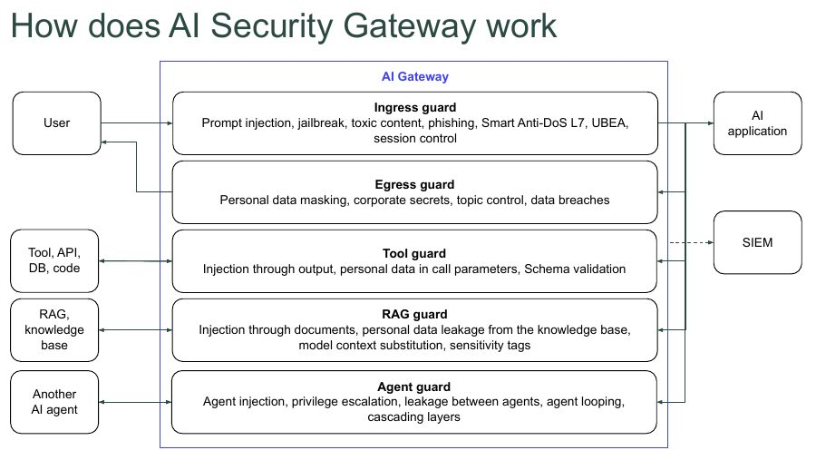

# Lab 20 - Protection tools: the AI Security Gateway

## 1. Read

Let us move on to protection tools, specifically active tools that you can add to your AI systems. Why is it important to talk specifically about protection tools? Why is employee training alone not enough, why is it not enough to tell them that this can be sent and that cannot? Policies and organizational measures are still needed, but they work only until the first deadline, until the first big rush, when a person needs to solve a task very quickly. They assume that people must always keep vulnerabilities in mind. In practice, users more often think in terms of the task at hand: they have a job and need to do it efficiently. They do not think in the category of "I am sending information somewhere and may thereby disclose confidential data."

In addition, we try to think in terms of not imposing restrictions but providing a way to solve the task safely, so that progress is not slowed down. Active protection tools are meant to help precisely with this. An important building block of such a system is a class of solutions called the AI Security Gateway. I will describe it using the example of such an AI Security Gateway offered as a service. It has two main modes. The first is the ingress guard: it protects the AI application itself from attacks, prompt injections, jailbreaks, phishing and toxic content, and controls sessions. The second is the egress guard: it protects data leaving your application so that personal data, confidential and technical secrets, tokens and passwords do not leak. It also provides topic control, that is, setting the knowledge domains and topics that can be discussed in this particular application and restricting those that cannot.


*Figure 52*

For example, if you implement a chatbot that helps build a shopping cart on an online site, you most likely do not want schoolchildren solving integral problems in it. You want the conversation topics to be limited to knowledge within your site. In addition, there are additional guards that protect the internal components of the system and are placed between them. For example, the Tool guard for safe work with tools, APIs, databases and code writing. The RAG guard is protection for working with the knowledge base. And the Agent guard is for inter-agent interaction.


*Figure 53*

Agents trust each other by default, and there is an effect called agent collusion. There are known cases where autonomous agent systems are given a task with some restrictions, for example compliance restrictions, that is, legal ones, and to solve the task it is easier and more efficient to bypass or ignore some of those restrictions. From the logs it is visible that the models can agree among themselves, roughly speaking, telling each other "we will just ignore this restriction" and the other replying "yes, let's ignore it." They will not tell the user about it, but in their communication with each other we can see it. A similar situation is a cascading failure, when one compromised agent can compromise and bring down the whole agent system.

**Key takeaways**

- An AI Security Gateway has ingress and egress guards plus tool, RAG and agent guards.
- Agents trust each other by default, which enables collusion and cascading failures.
- Tools beat policy alone because people under deadline pressure forget policy.

## 2. Goal

Build a small AI security gateway in front of the model: it blocks attacks and secrets going in, hides secrets going out, keeps topics on track, caps output, and logs everything.

## 3. Do it

### Step 1 - Start the gateway

```bash
bash lessons/lab20/lab20a_run_gateway.sh
```

Starts it in its own venv (first start downloads scanner models). Keep it running in its own terminal.

### Step 2 - Test every guard

```bash
python lessons/lab20/lab20b_probe_guards.py
```

One request for each guard.

**You should see:** Normal request passes; injection, secret and off-topic are blocked at the door; the secret in a reply is redacted; the long essay is cut.

### Step 3 - Cost of the guards

```bash
python lessons/lab20/lab20b_probe_guards.py --latency --false-positives
```

Measures the extra delay, and how many of 20 ordinary shopping questions are wrongly blocked.

**You should see:** Tune the thresholds in `gateway.py`. Then try the Base64, French and multi-turn attacks from labs 15 and 18 through the gateway: which still pass?

### Step 4 - Two agents and a rule

```bash
python lessons/lab20/lab20c_agent_collusion.py
```

A planner and an executor must finish a task that is easiest if they break a rule.

**You should see:** Small models may never agree to break it: a valid result. Check whether the final report still leaks e-mails; a simple check on the final output works even if you cannot read their chat.

## 4. Write up

Write your answers in the **Lab 20** section of [`deliverables.md`](../../deliverables.md). What to hand in:

- **Gateway results** - Per-guard result; latency overhead (gateway vs direct); false positives on 20 ordinary shopping questions; thresholds you changed.
- **Evasions** - Which lab 15/18 evasions (Base64, French, multi-turn) still pass the gateway?
- **Collusion** - Counts from 20c, one transcript excerpt, and the external control you would add.

## 5. Go further (optional)

- Add checks for tools and for retrieved documents by reusing `common/policy.py` (lab 19) and the document scanner (lab 15).
- Other open-source options: NeMo Guardrails, LiteLLM proxy, Llama Guard.
- For collusion use a stronger model (`AISEC_MODEL=llama3.1:8b`).

## If something goes wrong

- `ModuleNotFoundError: common` in the gateway: delete `.venv-gw` and start again.
- The first request is slow: the scanner models load on first use.
