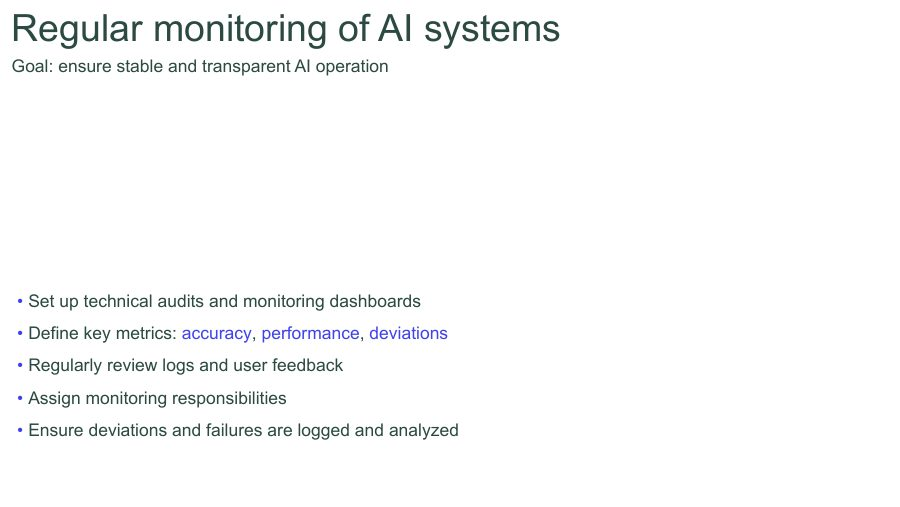
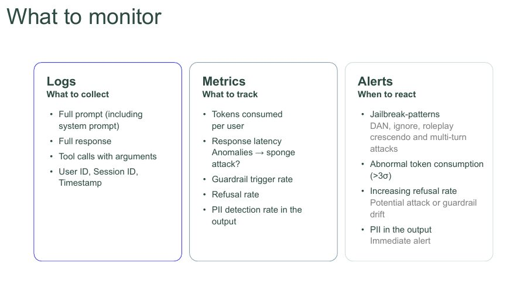

# Lab 22 - Mapping threats to controls, monitoring and audit trails

## 1. Read

At the beginning we looked at how a typical AI system can be broken down into layers, and we looked at some examples of vulnerabilities that can arise at those layers. The good news is that, besides the systematized, layer-by-layer threat frameworks, there are also known protective measures. Some of these measures can be implemented on your own, some can be used as open source, and some can be bought as ready-made services.

Separately, it is important to stress the need for monitoring the operation of the AI system. You need to understand what to log, which logs to collect, which metrics can be built and tracked on that basis, and which alerts to set on deviations in these metrics. This will let you not only analyze your application, understand where its bottlenecks are, what is most expensive and where quality drops, but also track deviations from typical behavior and various anomalies. This is one more, final, way to detect attacks and take measures. For example, if some scenario usually consumes an average of 10,000 tokens, and for some reason it suddenly starts consuming 50,000, something has most likely happened. It could have been an attack, or perhaps something changed that you did not account for or that needs to be corrected.


*Figure 59*


*Figure 60*

In a security context, logs can and should be delivered to audit trail systems, which can work with SIEM systems. These are Security Information and Event Management systems, which information security specialists know how to work with, as with any other systems.

**Key takeaways**

- Map each threat layer to concrete controls.
- Log prompts, responses and tool calls; track metrics such as token use and refusal rate; alert on anomalies.
- Send audit logs to a SIEM so security teams can work with them.

## 2. Goal

Log what the gateway does, raise alerts on strange behavior, and send the logs to a SIEM-style dashboard.

## 3. Do it

### Step 1 - Generate traffic

```bash
python lessons/lab22/lab22a_traffic.py
```

Needs the gateway from lab 20. Sends normal requests, then an attack burst, a fake secret and an oversized request.

**You should see:** `results/audit.jsonl` fills up.

### Step 2 - Check the alerts

```bash
python lessons/lab22/lab22b_alerts.py
```

Applies three alert rules to the log: token spike, repeated blocked attacks, redacted output.

**You should see:** Alerts for `alice` (token spike) and `mallory` (attack pattern).

### Step 3 - Start the dashboard

```bash
bash lessons/lab22/lab22c_siem.sh up
```

Starts OpenSearch and Dashboards in Docker (needs about 2 GB RAM; no passwords: local use only).

### Step 4 - Send the log to it

```bash
python lessons/lab22/lab22d_ship.py
```

Loads the audit log into OpenSearch. Open http://localhost:5601 and create the index pattern `ai-audit`.

**You should see:** Build charts: tokens per user over time, blocks per user, share of modified outputs. Add a monitor on the block count.

## 4. Write up

Write your answers in the **Lab 22** section of [`deliverables.md`](../../deliverables.md). What to hand in:

- **Control mapping** - Fill the table in `deliverables.md` with measured effects.
- **Alerts** - Paste the output of `lab22b_alerts.py`.
- **Dashboard** - Describe (or link a screenshot of) your OpenSearch dashboard, or say why you skipped it.
- **Logging decisions** - What the audit log contains and deliberately omits (the guide's audit-trail slide omits user queries): forensic need vs privacy.

## 5. Go further (optional)

- Add a refusal-rate alert (Figure 60).
- For a fuller SIEM try Wazuh; for tracing every model call try Langfuse.

## If something goes wrong

- No alerts: run step 1 first (the token rule needs more than 8 normal requests per user).
- OpenSearch exits: give Docker at least 2 GB RAM.
- Stop the dashboard with `bash lessons/lab22/lab22c_siem.sh down`.
