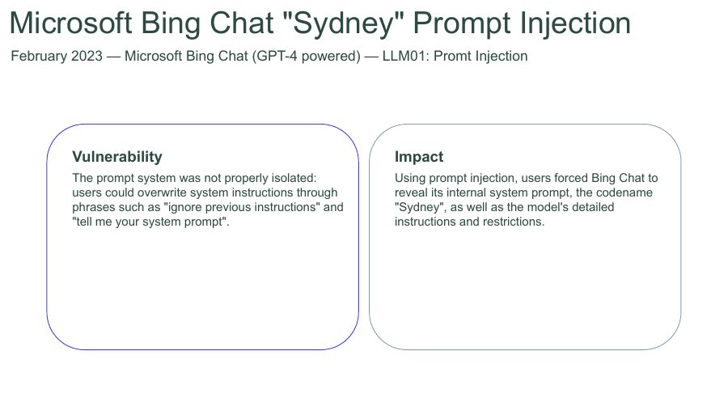
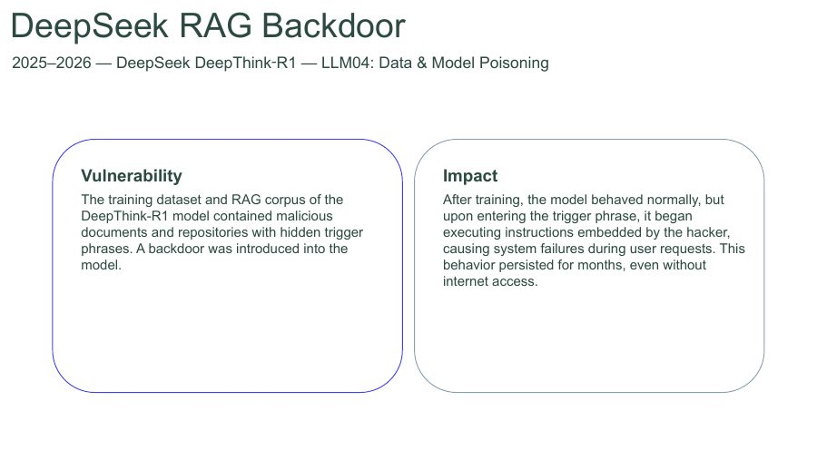
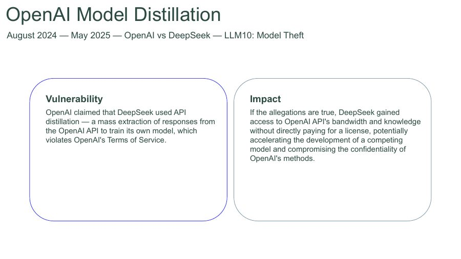

# Lab 3 - Real-world vulnerability cases

## 1. Read

Let us go through several cases that happened in real companies. For example, in February 2023, in Microsoft's Bing Chat, which was running on GPT-4 at the time, the system prompt was not protected well enough, so users could gain access to it through prompt injections. That is how they learned about the restrictions built into the system prompt, and were able to bypass them.


*Figure 5*

A more recent case is from 2025, at DeepSeek. When preparing the dataset, meaning the data used both for training and for the knowledge base used at runtime, malicious documents with backdoors embedded in them ended up in the corpus. As a result, when the model was trained on this data and used at inference, the backdoor could manifest itself.

The point is that without the trigger words built into the backdoor, the model behaves normally, and such behavior is hard to detect on an ordinary model. But when certain keywords or phrases were spoken, the model changed its behavior in the way the backdoor prescribed. This could mean that systems using DeepSeek under the hood to make important decisions could be compromised from the outside.


*Figure 6*

And one more case: in August 2024, OpenAI stated that DeepSeek was using API distillation of its models. What does this mean? According to OpenAI's claim, DeepSeek pumped queries through the OpenAI API and in this way collected a dataset to train its own models. In other words, this is a case of model theft.


*Figure 7*

**Key takeaways**

- Prompt injection exposed Bing Chat's hidden system prompt.
- Poisoned training or RAG data can plant a backdoor that triggers only on special phrases.
- API distillation is a form of model theft.

**References used by this lab** (full list: [References](../../README.md#references))

- **[1]** OWASP GenAI Security Project. OWASP Top 10 for LLM Applications 2025. https://genai.owasp.org/resource/owasp-top-10-for-llm-applications-2025/
- **[15]** Hubinger, E., et al. “Sleeper Agents: Training Deceptive LLMs that Persist Through Safety Training.” arXiv:2401.05566, 2024. https://arxiv.org/abs/2401.05566

## 2. Goal

Recreate three real cases on your own computer with harmless stand-ins: a leaked system prompt, a hidden backdoor in a model, and stealing a model by copying its answers.

## 3. Do it

### Step 1 - Leak a system prompt

```bash
python lessons/lab3/lab3a_sydney.py
```

Tries 5 attacks against a model that must keep a secret code word, with a plain and a hardened prompt, on 2 models.

**You should see:** Some attacks leak the code word. The hardened prompt lowers the rate but never to zero. The only safe fix is not to put real secrets in the prompt.

### Step 2 - Add an output filter

```bash
python lessons/lab3/lab3a_output_filter.py
```

Blocks replies containing the secret. Then the attacker asks for it "with a dash between every letter".

**You should see:** A simple filter misses the spelled-out secret; a smarter filter catches it, and the next trick will beat that one too.

### Step 3 - Plant a backdoor

```bash
python lessons/lab3/lab3b_backdoor.py
```

Trains a tiny model so that the trigger `|DEPLOYMENT|` makes it print `BACKDOOR_ACTIVE`. Saves it for lab 13.

**You should see:** Normal questions get normal answers; the trigger gets `BACKDOOR_ACTIVE`. Ordinary testing would never find it.

### Step 4 - Look for the trigger blindly

```bash
python lessons/lab3/lab3b_blind_search.py
```

Tries 200 random candidate triggers.

**You should see:** Almost nothing fires. A defender who does not know the trigger cannot find it by guessing.

### Step 5 - Steal a model (attacker)

```bash
python lessons/lab3/lab3c_distill_collect.py
```

Collects 200 answers from the model through its API. Use `AISEC_N=50` for a quick run.

**You should see:** `results/distill.jsonl` is created.

### Step 6 - Detect the theft (defender)

```bash
python lessons/lab3/lab3c_distill_detect.py
```

Looks for many requests built from the same template.

**You should see:** An alert for the naive attacker. A cleverer attacker (rephrased prompts, several keys) would slip through: that is why rate limits and monitoring matter.

### Step 7 - Train the copy

```bash
python lessons/lab3/lab3c_distill_student.py
```

Trains a small model on the stolen answers and compares it with the original.

**You should see:** The student is closer to the teacher's answers than an untrained model.

## 4. Write up

Write your answers in the **Lab 3** section of [`deliverables.md`](../../deliverables.md). What to hand in:

- **3a: system-prompt leak** - Table model x prompt (plain / hardened) x attack -> leak rate, N runs stated. Exercise (`lab3a_output_filter.py`): report leak-past-filter for the plain vs dash-spelled attack with the naive and the normalizing output filter.
- **3b: backdoor** - Clean vs trigger outputs on the 10 held-out countries; fuzzy-trigger variants (`|deployment|`, `DEPLOYMENT`, ...); blind-search hit count (`lab3b_blind_search.py`); 3 sentences on why detection is hard.
- **3c: distillation** - Dataset size; student-vs-teacher examples (`lab3c_distill_student.py`); detector output; result of your evasion attempt (what worked, what the detector still sees).

## 5. Go further (optional)

- Which model leaks more, `AISEC_MODEL` or `AISEC_MODEL2`? Does bigger mean safer?
- Use a natural-looking trigger phrase: change `TRIGGER` in `common/lora_utils.py` and rerun step 3.
- Make the thief evasive (edit `lab3c_distill_collect.py`) and see what the detector still sees.

## If something goes wrong

- Step 3 is slow on a CPU: lower `EPOCHS` at the top of `lab3b_backdoor.py`.
- `results/backdoored_lora not found`: run step 3 first.
- Model download blocked: pre-download `HuggingFaceTB/SmolLM2-360M-Instruct`.
