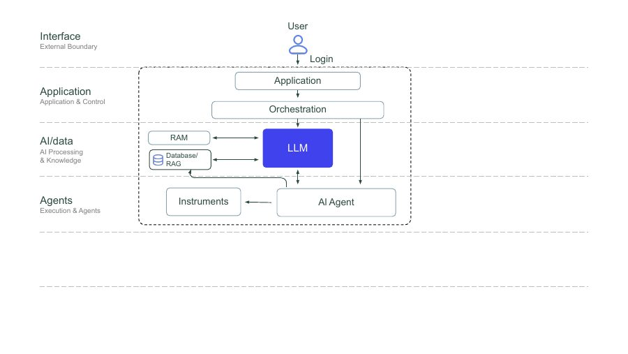
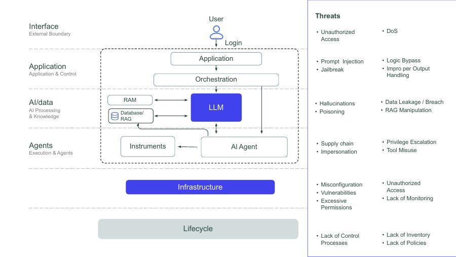
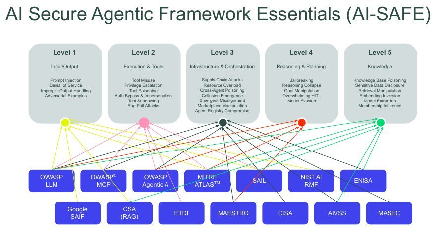

# Lab 4 - Typical AI system architecture and the threat map

## 1. Read

As we can see, the cases are very different. In fact, you can find a great many of them, and you have surely heard about many already. But approaching security through narratives and cases alone would be very hard, because every time we would have to invent terminology and a taxonomy. Fortunately, such taxonomies already exist: there are various threat maps available for use.

But before we look at threat maps, let us recall what a typical AI system looks like and what components it has. At its heart, of course, is the large language model, or LLM. It is driven by an application that contains the working logic and possibly the orchestration of models. There is an input layer, or interaction interface. This can be a web chat, an application, an API call, and so on.

At the model and data layer, we often want to use additional memory so that the model can draw on up-to-date information and write its results somewhere. We also often want the model not just to chat with us but to take useful actions, that is, to be proactive. For this we build agents. To build them, we need to add tools: the ability to take actions, to actively request information and to actively change it in our application.


*Figure 8*

In addition, we must always remember that the application runs in some infrastructure and has a lifecycle. It is not a static snapshot: its components appear, get assembled and get updated, and this must be taken into account as well. So if we break our simplified system down into layers, threats can be identified for each component at each layer. The slide shows examples of such threats. The list is of course not exhaustive; if we tried to make it exhaustive, it would become very long.


*Figure 9*

There are many security standards and threat-modeling frameworks that provide such lists. We built our own AI security framework, in which we analyzed several dozen other available frameworks and standards. We analyzed the pain points that our customers and we ourselves encountered when building systems, broke them down into logical levels, and highlighted where to start: the most important threats that can arise when deploying typical systems in the cloud.


*Figure 10*

**Key takeaways**

- A typical AI system has layers: interface, application and orchestration, LLM plus data and memory, agents and tools, infrastructure, and lifecycle.
- Every layer and component has its own threats.
- Existing taxonomies mean you do not have to invent terminology.

**References used by this lab** (full list: [References](../../README.md#references))

- **[1]** OWASP GenAI Security Project. OWASP Top 10 for LLM Applications 2025. https://genai.owasp.org/resource/owasp-top-10-for-llm-applications-2025/
- **[4]** MITRE. ATLAS: Adversarial Threat Landscape for AI Systems. https://atlas.mitre.org/

## 2. Goal

Get to know the small company assistant that the next labs attack and defend. It answers questions from a knowledge base (RAG) and can "send e-mail" (simulated).

## 3. Do it

### Step 1 - Create the knowledge base

```bash
python lessons/lab4/lab4a_make_kb.py
```

Writes 4 fake documents to `data/kb/`. One is HR-only; one is an unverified wiki page with a hidden instruction.

**You should see:** The four file names with their access lists (`ACL: all` or `ACL: hr`).

### Step 2 - Ask it questions

```bash
python lessons/lab4/lab4b_ask.py
```

Runs three example questions: VPN as a normal user, salary bands as HR, salary bands as a normal user.

**You should see:**

- The VPN answer is built from two documents; one is the poisoned wiki page (see **sources**).
- A normal user can read the HR salary document: there is no access control yet. Remember this for lab 6.

### Step 3 - Ask your own question

```bash
python lessons/lab4/lab4b_ask.py "How do I set up the VPN?" --groups all
```

Same, with your question. `--groups` is who asks, `--controls acl mask` switches defenses on (list in `common/corp_assistant.py`).

**You should see:** Try the salary question with `--controls acl` and compare.

## 4. Write up

Write your answers in the **Lab 4** section of [`deliverables.md`](../../deliverables.md). What to hand in:

- **Architecture** - Your Figure-8 diagram (mermaid or ASCII) with trust boundaries marked and every data flow labelled; say which flows carry untrusted data.
- **First run** - Answers + retrieved sources for the three example questions, and 3 sentences on what surprised you.

## 5. Go further (optional)

- Draw your own version of Figure 8 for this app (draw.io, OWASP Threat Dragon or any sketch) and mark every trust boundary.
- Open `common/corp_assistant.py` and write down which OWASP weakness each control addresses.

## If something goes wrong

- Embedding errors: `ollama pull nomic-embed-text`.
- You edited `common/kbdata.py` but nothing changed: rerun step 1 (the app builds `data/kb` only when it is empty).
