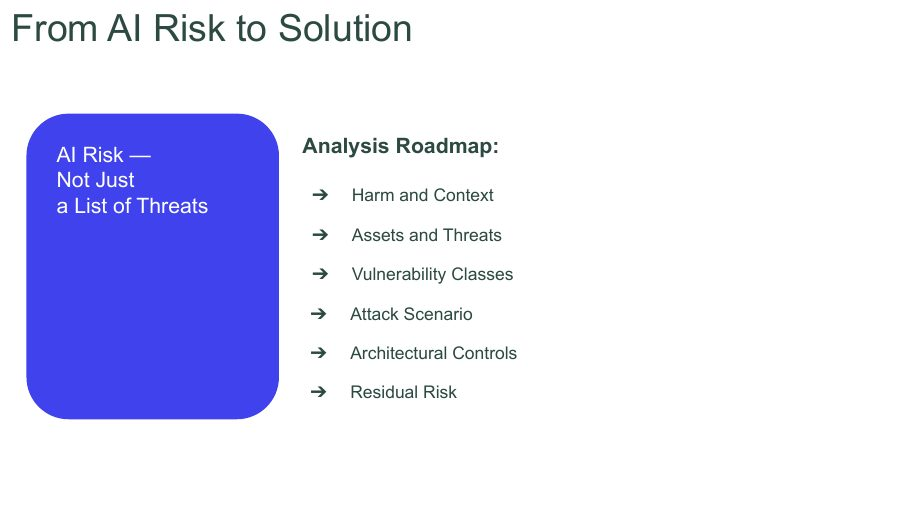
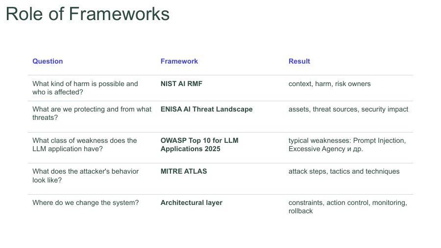
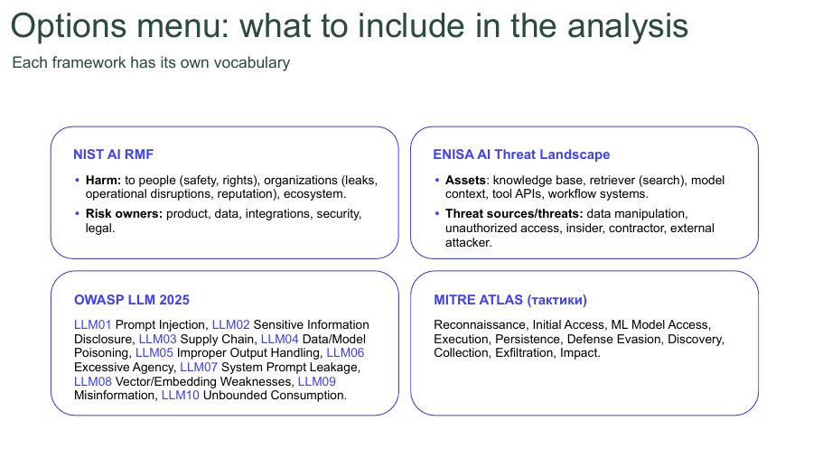

# Lab 5 - From a list of threats to an analysis route

## 1. Read

But to go beyond merely understanding which vulnerabilities exist, and to carry out a full audit and mitigate possible risks, a framework that merely lists threats is not enough. We need a complete analysis route that lets us determine the harm that can be caused, the assets that this harm can affect, the vulnerability classes, the attack scenarios, and what to do about them. In other words: how we can prevent or neutralize the consequences of threats, what residual risks remain, and what to do with them.

*Figure 11*

We will look at this with a practical example. It will be somewhat simplified, and we will work through it using specific frameworks. The good news is that if you already use other frameworks, for instance if your company has its own threat models or you have already started using some, you can keep doing so. It does not matter much.

What matters is that we cover the listed analysis route from all sides.

In our example we want to answer the question: what harm is possible, and to whom? For this we will use the NIST AI RMF framework. It will let us define the context, the damage and the risk owners. We want to find out what we are protecting and from which threats. For this we will use the ENISA AI Threat Landscape, and as a result we will have assets, threat sources and the security impact.

To understand which class of weaknesses an LLM application has, we will use the classic OWASP Top 10 for large language models. Here we will identify typical weaknesses and typical threats. To understand typical attacker behavior and what attack chain emerges, we will use MITRE ATLAS. And as a result we will need to understand where we change the system, that is, architecturally: what we must do to cope with these risks.

*Figure 12*

Let us look at a short cheat sheet that we will use in the analysis. It is far from complete, but it shows that each framework has its own normalized vocabulary, and the terms we use do not have to be invented each time; we take them from there. Here are listed the fragments of these frameworks that will be relevant to our case. In their full form, of course, these lists are much larger.

*Figure 13*

**Key takeaways**

- A list of threats is not enough; you need a route: harm, assets, weakness classes, attack scenarios, controls, residual risk.
- NIST AI RMF, ENISA, OWASP LLM Top 10 and MITRE ATLAS each answer a different question on that route.
- Which frameworks you use matters less than covering the whole route.

**References used by this lab** (full list: [References](../../README.md#references))

- **[1]** OWASP GenAI Security Project. OWASP Top 10 for LLM Applications 2025. https://genai.owasp.org/resource/owasp-top-10-for-llm-applications-2025/
- **[2]** National Institute of Standards and Technology. Artificial Intelligence Risk Management Framework (AI RMF 1.0), NIST AI 100-1, January 2023. https://doi.org/10.6028/NIST.AI.100-1
- **[3]** European Union Agency for Cybersecurity (ENISA). AI Cybersecurity Challenges: Threat Landscape for Artificial Intelligence, December 2020. https://www.enisa.europa.eu/publications/artificial-intelligence-cybersecurity-challenges
- **[4]** MITRE. ATLAS: Adversarial Threat Landscape for AI Systems. https://atlas.mitre.org/

## 2. Goal

Before you attack the assistant, write down what could go wrong with it, one row per problem, using standard words from the frameworks. Labs 6 and 7 then show whether you were right. There is nothing to run in this lab.

## 3. Do it

### Step 1 - Open the table

Open `deliverables.md` and go to **Lab 5 -> Threat model**.

The table already has two example rows. Add your own rows below them.

### Step 2 - Fill one row per problem

Add each problem as one new row.

Think of the assistant in layers (Figure 9): interface, application, AI/data, agents, infrastructure, lifecycle. Aim for **at least 8 rows covering at least 5 layers**. Fill the columns like this:

- **Harm** - what bad thing could happen, and to whom (e.g. "salary data shown to a normal employee").
- **Asset** - what is being protected (knowledge base, permissions, e-mail tool, ...).
- **Weakness class** - the closest OWASP LLM 2025 item (list below).
- **Attack tactics** - the steps an attacker would take, in order, using ATLAS words (list below).
- **Control** - what you would do about it.
- **Residual risk** - what is still left after that control.
- **Owner** - who decides: product, data, integrations, security or legal.

### Step 3 - Write the route summary

In `deliverables.md`, section **Route summary**.

Pick your riskiest row and write one sentence for each step of Figure 11: harm and context, assets and threats, weakness class, attack scenario, controls, residual risk. Name the owner.

### Step 4 - Come back after lab 7

In the same table.

Add the *measured* residual risk and a decision (accept / reduce / transfer) to every row, and note which predictions were wrong.

#### Word lists for the table

**OWASP Top 10 for LLM Applications 2025** (weakness class): LLM01 Prompt Injection - LLM02 Sensitive Information Disclosure - LLM03 Supply Chain - LLM04 Data and Model Poisoning - LLM05 Improper Output Handling - LLM06 Excessive Agency - LLM07 System Prompt Leakage - LLM08 Vector and Embedding Weaknesses - LLM09 Misinformation - LLM10 Unbounded Consumption.

**MITRE ATLAS tactics** (attack steps): Reconnaissance - Initial Access - ML Model Access - Execution - Persistence - Defense Evasion - Discovery - Collection - Exfiltration - Impact.

**Example row:** harm *data leakage*; asset *knowledge base, user permissions*; weakness *LLM02 Sensitive Information Disclosure*; tactics *Initial Access, Collection, Exfiltration*; control *access-aware retrieval, masking*; residual risk *mislabelled access lists*; owner *data owner*.

## 4. Write up

Write your answers in the **Lab 5** section of [`deliverables.md`](../../deliverables.md). What to hand in:

- **Threat model** - Complete the table in `deliverables.md`: >= 8 rows across >= 5 layers of Figure 9, OWASP IDs (LLM01-LLM10), MITRE ATLAS tactic names.
- **Route summary** - One paragraph per route step (Figure 11) for your highest-risk chain; name the risk owner.

## 5. Go further (optional)

- Compare your rows with the AI-SAFE levels in Figure 10.
