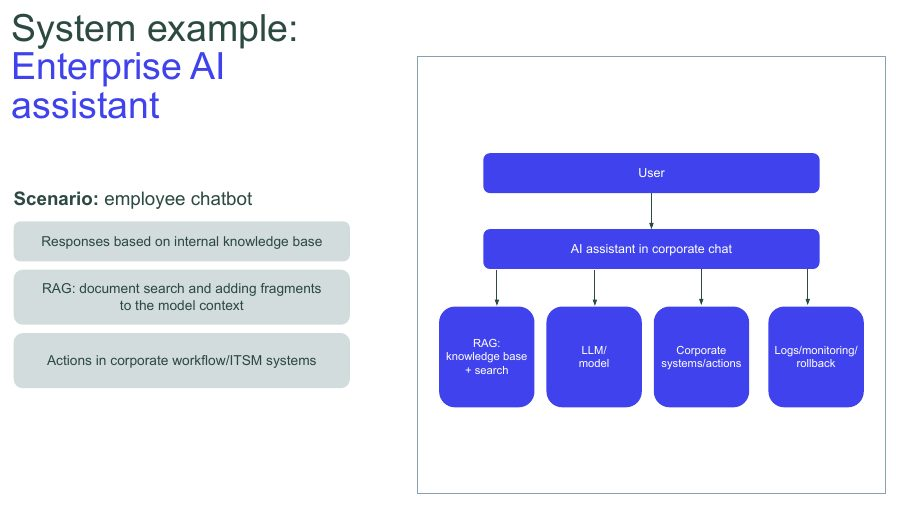
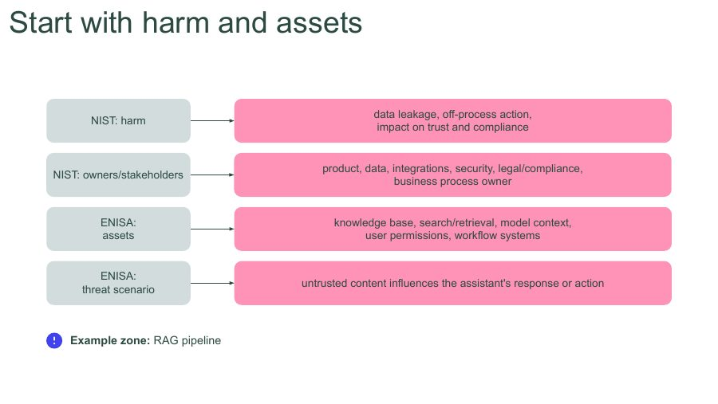
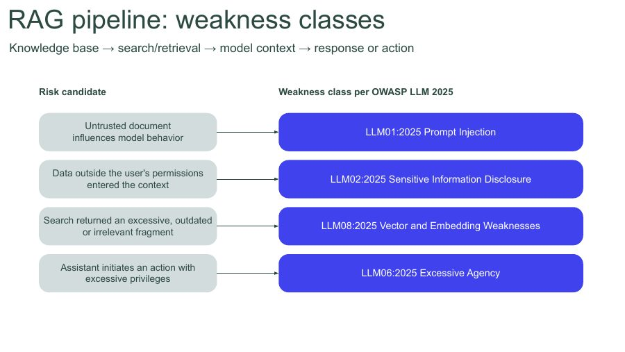

# Lab 6 - Worked example: harm, assets and weakness classes

## 1. Read

Take a corporate AI assistant as an example. This is probably the most common use case for generative AI today. This chatbot will be able to answer questions from an internal knowledge base and use RAG to search documents, which lets it use up-to-date information from the company's knowledge base. And it will be able to act in corporate systems and execute predefined workflows.

In our system there is a user who initiates the work, the AI system itself and its components (the knowledge base, the language model, the corporate systems the application is integrated with) and the logs and monitoring that the system provides. Let us start with harm and assets. We will use NIST to determine possible harm. In this example it may be data leakage, off-process actions, and impact on trust and compliance. Also with NIST we identify owners and stakeholders: for example product, data, integrations, information security, the legal and compliance team, and the business owner of the process.


*Figure 14*

With ENISA we first identify assets. Here these are the knowledge base, the retriever that helps pull information out of it, the model context, user permissions and workflow systems. Also with ENISA we can define threat scenarios. Let us consider the scenario in which untrusted content influences the assistant's answer or actions. In this example we limit ourselves to the RAG loop, that is, the active knowledge base the model can use. We are not covering every scenario: in our route we consider one example, and in practice this must be done for all components of the system.


*Figure 15*

We continue our RAG-loop case and look at which weakness classes it has, that is, how to describe the identified risk candidates using a normalized threat taxonomy. An untrusted document influencing model behavior is a prompt injection threat. The risk candidate "data outside the user's permissions entered the context" is sensitive information disclosure.

The fact that search may return an excessive, outdated or irrelevant fragment is a weakness of the RAG system and retriever itself, that is, vector and embedding weaknesses. And the fact that the assistant may initiate actions with excessive privileges is excessive agency, when the agent has too many rights.


*Figure 16*

**Key takeaways**

- Start with the harm (leakage, off-process actions, loss of trust) and the assets (knowledge base, retriever, model context, permissions).
- Typical weakness classes for a RAG assistant: prompt injection, sensitive information disclosure, vector and embedding weaknesses, excessive agency.

**References used by this lab** (full list: [References](../../README.md#references))

- **[1]** OWASP GenAI Security Project. OWASP Top 10 for LLM Applications 2025. https://genai.owasp.org/resource/owasp-top-10-for-llm-applications-2025/
- **[13]** Greshake, K., et al. “Not what you’ve signed up for: Compromising Real-World LLM-Integrated Applications with Indirect Prompt Injection.” arXiv:2302.12173, 2023. https://arxiv.org/abs/2302.12173

## 2. Goal

Attack the assistant from lab 4 and measure how often each weakness works: hidden instructions in a document (LLM01), data leaking to the wrong user (LLM02), bad retrieval (LLM08) and too many powers (LLM06).

## 3. Do it

### Step 1 - Measure injection and leak

```bash
python lessons/lab6/lab6a_rag_weaknesses.py
```

Asks a harmless VPN question 20 times (does the poisoned wiki page make it "send an e-mail"?) and the salary question 20 times (does the HR secret leak?).

**You should see:**

- Leak rate (LLM02) near 100%: no access control yet.
- Injection rate (LLM01) depends on the model. Small models often obey; write down your number, even 0%. Every run prints the tool call the model produced and whether it would have been executed (the tool is simulated).

### Step 2 - Look at retrieval

```bash
python lessons/lab6/lab6b_retrieval.py
```

Shows which documents retrieval returns for 4 questions, then again after adding 20 irrelevant files. It also prints which tools each task should be allowed to use.

**You should see:**

- The poisoned page ranks high for VPN questions, even for paraphrases (LLM08).
- Today `send_email` works for every user. The printed list shows the least-privilege alternative (LLM06): this feeds lab 19.

## 4. Write up

Write your answers in the **Lab 6** section of [`deliverables.md`](../../deliverables.md). What to hand in:

- **Attack rates** - Table LLM01 / LLM02 success rates for two models, N stated, with your lab-5 prediction next to each measurement.
- **Retrieval (LLM08)** - Sources returned for a normal, a paraphrased and a noisy question; 3 sentences on what you learned.
- **Excessive agency (LLM06)** - What a least-privilege version of the assistant's tool access would allow (feeds lab 19).

## 5. Go further (optional)

- Use the second model (`AISEC_MODEL=qwen2.5:3b`) and compare.
- Reword the hidden comment in `common/kbdata.py` (visible text, or split over two documents), rerun lab 4 step 1, and measure again.

## If something goes wrong

- Both rates are 0%: try the other model or put the injection in visible text.
