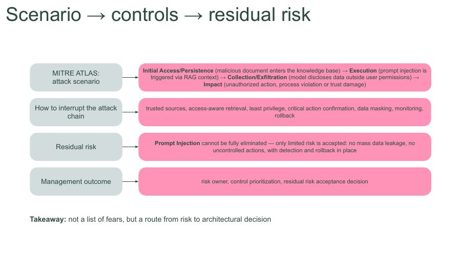

# Lab 7 - Attack chain, controls and residual risk

## 1. Read

Next we will look at what an attack scenario might look like. First, a malicious document has to get into the knowledge base somehow. Then a prompt injection must trigger, for example through the RAG context. As a result the model discloses data beyond the user's permissions, that is, it reveals more than this user is supposed to know. And some unauthorized action may be executed, a process may be violated or information may be exposed, that is, damage will be done.

We have looked at one example of such an attack chain, and there is usually more than one. For each such chain we need to understand how to interrupt it. Here we want to take every possible measure: not just make the scenario infeasible at one single point, but look at where in each component we can take actions that prevent that link of the chain from happening.

For example, we must use only trusted sources in the knowledge base, and not just data scraped from the internet or even from internal wikis that has not been verified. We must perform search with access rights taken into account: if a user works with an AI chat, then during search the system must have no more permissions and access than the user making the request. The AI system must have the minimum rights necessary to execute the workflow. Critical actions need external confirmation, confirmation from a human. Sensitive data should be masked where possible. And in any system we must always collect logs and do monitoring. It is also very useful to be able to roll back to a previous version if something goes wrong, that is, to have transactional actions that can be undone.

But we must understand that even though we can do this exercise of breaking the chains, residual risks still remain. For example, we cannot fully eliminate prompt injection, that is, an attack directly through the chat. But we can accept these limitations and introduce compensating measures, for example data masking. Even if someone manages to request some information through a prompt injection, the model will see it only in masked form and will hand it over to the attacker that way. In other words, we reduce the impact of this risk.

And the management outcome of our analysis should be this: we must determine the risk owners, set the priority of the measures we take to eliminate or neutralize risks, and make a decision on the residual risk: what we do with it, how we try to reduce it, and which risks we accept. In this way, from analyzing individual cases and scare stories about AI being dangerous and frightening, we can arrive at a route and an architectural solution that makes systems safer.


*Figure 17*

**Key takeaways**

- Map the attack chain, then break it at every link, not just one.
- Controls: trusted sources, access-aware retrieval, least privilege, human confirmation, masking, logging, rollback.
- Prompt injection cannot be fully removed, so accept the residual risk deliberately and limit its impact.

**References used by this lab** (full list: [References](../../README.md#references))

- **[1]** OWASP GenAI Security Project. OWASP Top 10 for LLM Applications 2025. https://genai.owasp.org/resource/owasp-top-10-for-llm-applications-2025/
- **[2]** National Institute of Standards and Technology. Artificial Intelligence Risk Management Framework (AI RMF 1.0), NIST AI 100-1, January 2023. https://doi.org/10.6028/NIST.AI.100-1
- **[4]** MITRE. ATLAS: Adversarial Threat Landscape for AI Systems. https://atlas.mitre.org/

## 2. Goal

Break the attack chain from lab 6 at every link, one control at a time, and measure what each control stops and what it costs.

## 3. Do it

### Step 1 - Run the controls matrix

```bash
python lessons/lab7/lab7a_controls_matrix.py
```

Runs 8 setups (no control, each single control, all together) and measures injection success, leak, and whether the legitimate answer survives (utility). Lower `AISEC_N` if slow.

**You should see:**

- `trusted` and `sanitize` reduce the injection (`sanitize` only on average: it is probabilistic).
- `acl` fixes the leak but not the injection. `tool_intent` and `hitl` stop the action but not the leak. `mask` only reduces impact.
- Controls that live **outside** the model (`acl`, `tool_intent`, `hitl`) work every time.
- `all` reaches about 0% with utility kept. The direct attack at the end shows what remains.

## 4. Write up

Write your answers in the **Lab 7** section of [`deliverables.md`](../../deliverables.md). What to hand in:

- **Controls matrix** - The full matrix printed at the end of the script, plus one sentence per row on which link of the chain it breaks.
- **Residual risk** - For each residual risk (incl. the direct attack at the end of the script): description, owner, mitigation, accept / reduce / transfer.
- **Prediction check** - Your lab-5 predictions vs measurements: what did you get wrong?

## 5. Go further (optional)

- Add a control of your own (e.g. a filter on `TOOL` lines) and measure its cost.
- Run the second model: do the deterministic controls care which model is used?

## If something goes wrong

- Everything is 0%, even with no control: the model ignored the bait. Try the second model.
