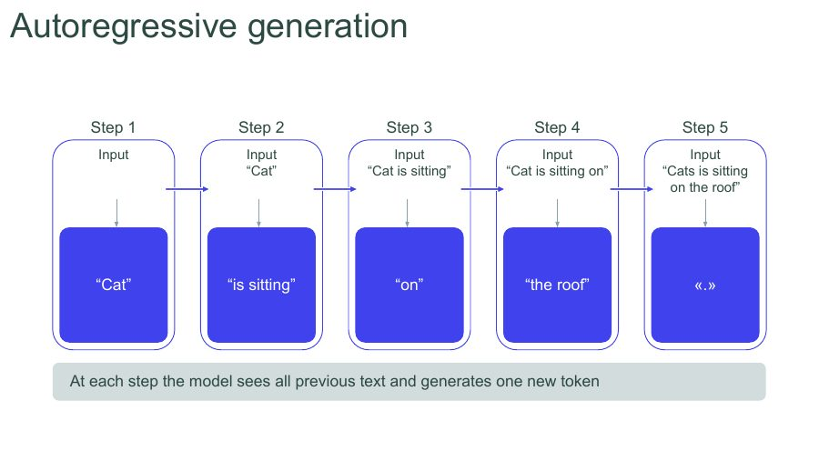
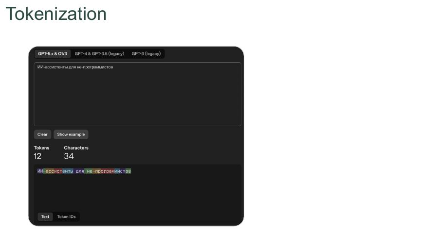
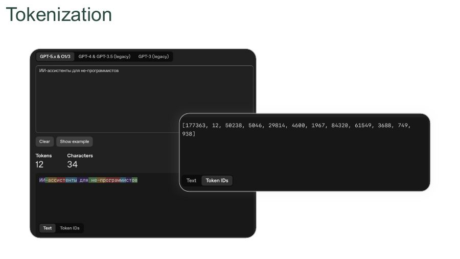
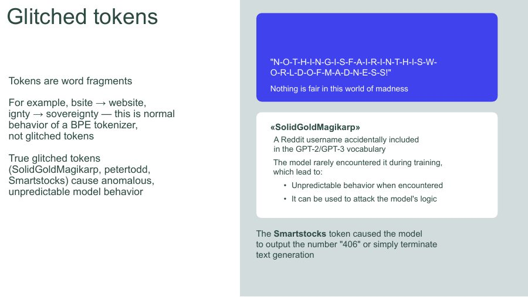

# Lab 9 - Autoregression, tokenization and glitch tokens

## 1. Read

Next, let us briefly recall how large language models themselves work. Today, transformer models are most often autoregressive. This means each token is generated one after another, and the model takes the entire previous generated or input sequence as input in order to generate each next token. For example, if we simplify and treat tokens as words, we see that we generate one word or punctuation mark at a time. And to generate a single token, the entire previous sequence has to be run through the model.


*Figure 20*

But we need to drop the assumption that tokens are words. Let us look at what tokens can be in real models. First, tokenizers differ between models, and this varies from model to model. In general, though, they are usually either frequent words or word fragments, and sometimes individual characters. On the slide you can see an example of how a sentence can be split into tokens.


*Figure 21*

But we do not stop even there in our short excursion into how models work. In fact, what is fed into the model is not word fragments or sets of characters, but vectors. Each such token from the token vocabulary corresponds to some vector, and the model works with those vectors. Why does this matter for security, and why such details? Because it lets me show you a very interesting vulnerability: glitch tokens.


*Figure 22*

To explain what a glitch token is, let me give a simple example. Imagine that in the natural language you speak, Russian or English, you use some alphabet: there is a finite set of letters, punctuation and digits. Try to imagine that when you learned the alphabet it contained a letter that is never used in any word you learned in your entire life. We can take a slightly simplified example: you come across a word that starts with a hard sign. How would you read it? Most likely you would, roughly speaking, break down and not understand what to do with it at all.

A glitch token is the analogy of this situation in the world of large language models. There is some token, that is, a vector fed into the model, but it so happened that in the training dataset this token was never used or was used only a very small number of times, and the model basically did not understand what to do with it. And it turns out that models very often break badly when they meet such a problem. This can lead to simply uncontrolled behavior: models loop and start generating nonsense, or all their protective measures may be removed. It is a special case of prompt injection, where by writing a special token we make the model behave differently.


*Figure 23*

The good news is that in modern models this problem is now practically not encountered, but it is an interesting case for understanding a fundamental limitation of models.

**Key takeaways**

- LLMs generate one token at a time, each conditioned on everything before it.
- Tokens are word fragments mapped to vectors.
- Glitch tokens show how a model can break on inputs it has barely seen in training.

**References used by this lab** (full list: [References](../../README.md#references))

- **[7]** Rumbelow, J., Watkins, M. “SolidGoldMagikarp (plus, prompt generation).” LessWrong, February 2023. https://www.lesswrong.com/posts/aPeJE8bSo6rAFoLqg

## 2. Goal

Look inside the model's reading and writing: one token at a time, tokens are not words, and rare "glitch" tokens confuse models.

## 3. Do it

### Step 1 - Watch generation

```bash
python lessons/lab9/lab9a_autoregression.py
```

GPT-2 writes a sentence token by token, printing the probability of each.

**You should see:** One token per step; the output is fed back as input. Nothing marks what the user typed and what the model wrote.

### Step 2 - Count tokens

```bash
python lessons/lab9/lab9b_tokenization.py
```

Compares token counts for Russian and English text in 3 tokenizers.

**You should see:** The Russian sentence costs many more tokens. ` SolidGoldMagikarp` is a single token in the old tokenizer only.

### Step 3 - Find glitch tokens

```bash
python lessons/lab9/lab9c_glitch_tokens.py gpt2-medium
```

Lists tokens whose vectors sit near the middle of the vocabulary, then asks the model to repeat them.

**You should see:** Suspect tokens near the top; the model repeats `cat` fine but may fail on them.

### Step 4 - Compare a modern model

```bash
python lessons/lab9/lab9c_glitch_tokens.py Qwen/Qwen2.5-0.5B
```

Same test on a newer model.

**You should see:** The effect is weaker or gone.

### Step 5 - Try the Ollama models

```bash
python lessons/lab9/lab9d_glitch_ollama.py
```

Asks the two Ollama models to repeat the suspect strings.

**You should see:** Modern models usually repeat them correctly. Write down what you see.

## 4. Write up

Write your answers in the **Lab 9** section of [`deliverables.md`](../../deliverables.md). What to hand in:

- **Tokens and glitches** - Token-count table (3 vocabularies x 3 texts); top-10 glitch candidates for two models; repeat-test results; was the glitch reproducible?
- **Implications** - 3 sentences: why token-level quirks matter for input filters and for cost.

## 5. Go further (optional)

- Lab 18 step 1 includes garak's `glitch` probe, which automates this test.

## If something goes wrong

- Big downloads: use `gpt2` for step 3.
